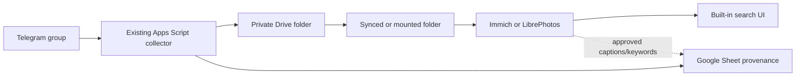
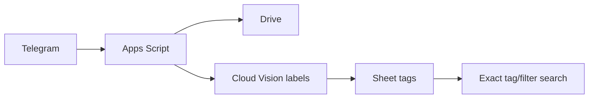
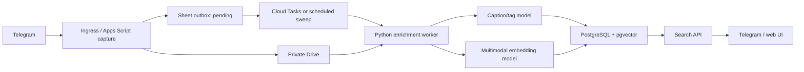

# Research Report: Automated Image Tagging and Semantic Image Search

**Date:** 2026-07-23
**Prepared for:** Admin
**Research Type:** Technical

---

## Research Overview

This research asks how photos already extracted from a Telegram group into private Google Drive storage can become searchable by both simple categories such as `art`, `activity`, and `sports`, and descriptive requests such as “activity with horses in an open area.” It evaluates no-build cloud products, self-hosted and desktop photo applications, managed vision APIs, multimodal embedding services, open models, storage/index choices, and search interfaces both inside and outside the existing workflow.

The review examined 315 Exa results across six independent workstreams, then retained primary papers, official product documentation, repositories, model cards, pricing pages, and the current repository implementation as the decision evidence. Current claims were rechecked on 2026-07-23. Product documentation establishes capability, not quality on this collection; Arabic, Egyptian Arabic, Arabizi, Telegram compression, target hardware, privacy terms, and lifecycle behavior therefore remain pilot questions.

The central finding is simple: **embeddings rank; tags explain, filter, and export**. Tags alone will not reliably answer compositional natural-language queries. The recommended next step is a two-track proof using the same private, judged photo/query set: Immich as the external-product finalist, and SigLIP 2 with exact cosine ranking as the minimum custom finalist. No database, queue, API, or new search UI should be built until one route passes the hard privacy, authorization, deletion, portability, Arabic-quality, and recovery gates described in the Research Synthesis.

## Executive Summary

The working Telegram → Drive → Sheets collector should remain the source/provenance path. Semantic enrichment must be asynchronous or external so a slow model cannot delay Telegram acknowledgement or corrupt capture. The Sheet may remain the POC ledger; if a custom route wins, PostgreSQL becomes a rebuildable searchable projection rather than a second authority for originals.

**Required finalists**

1. **Immich:** documented contextual CLIP search, selectable multilingual models, filters, OCR/tags, APIs, and a complete photo UI. It requires real Docker hosting, synchronization, upgrades, backup, and authorization operations.
2. **SigLIP 2 + exact similarity:** the smallest open custom benchmark. Add Florence-2 captions only if visible descriptions, OCR, or portable tags measurably improve the job.

**Conditional challengers**

- Google Photos is a manual, no-build user-experience benchmark only where consumer-cloud processing is approved; current APIs do not make its consumer semantic search a programmable backend.
- LibrePhotos is useful when visible generated captions/object classes are a hard requirement.
- Cloud Vision + Sheet is a valid stopping point when controlled tags and uploader text satisfy the judged queries.
- Managed multimodal embeddings plus pgvector become relevant only when custom Telegram search is required and self-hosting is rejected.
- Excire Foto is the polished offline option for a single curator where its prompt-language limits are acceptable.

## Table of Contents

1. [Technical Research Scope Confirmation](#technical-research-scope-confirmation)
2. [Technology Stack Analysis](#technology-stack-analysis)
3. [Integration Patterns Analysis](#integration-patterns-analysis)
4. [Architectural Patterns and Design](#architectural-patterns-and-design)
5. [Implementation Approaches and Technology Adoption](#implementation-approaches-and-technology-adoption)
6. [Technical Research Recommendations](#technical-research-recommendations)
7. [Research Synthesis](#research-synthesis)

---

## Technical Research Scope Confirmation

**Research Topic:** Automated image tagging and semantic image search for Telegram-extracted photos
**Research Goals:** Compare open-source and low-cost external applications and integrated algorithms; recommend a phased architecture for accurate multilingual tag, semantic, and hybrid image retrieval.

**Technical Research Scope:**

- Architecture Analysis - design patterns, frameworks, system architecture
- Implementation Approaches - development methodologies, coding patterns
- Technology Stack - languages, frameworks, tools, platforms
- Integration Patterns - APIs, protocols, interoperability
- Performance Considerations - scalability, optimization, patterns

**Research Methodology:**

- Current web data with rigorous source verification
- Multi-source validation for critical technical claims
- Confidence level framework for uncertain information
- Comprehensive technical coverage with architecture-specific insights

**Scope Confirmed:** 2026-07-23

## Technology Stack Analysis

### Research Coverage and Evidence Quality

The complete research reviewed 315 Exa search results across six independent workstreams:

1. open-source image retrieval, captioning, and tagging models;
2. open-source photo-management applications;
3. commercial and desktop catalogs;
4. managed tagging, captioning, and multimodal APIs;
5. low-cost integration, queueing, storage, and hybrid-search stacks; and
6. interoperability, metadata portability, and search interfaces.

The workstreams deduplicated results by URL and product, deep-read the strongest candidates, and retained first-party papers, official documentation, current pricing pages, model cards, and primary repositories. Third-party roundups were excluded when a primary source was available. Product capacity statements remain vendor estimates unless independently benchmarked.

**Confidence framework:**

- **High:** current official documentation, current pricing pages, primary repositories, and author papers agree.
- **Medium:** capability is documented, but Arabic accuracy, Telegram-photo performance, or target-hardware cost is untested.
- **Low:** marketing language, community reports, or undocumented assumptions; these are excluded from architectural decisions.

### Current Project Baseline

The implemented POC is a Google Apps Script webhook that saves Telegram photos to a private Google Drive folder and appends one indexed row to Google Sheets. It preserves a deliberately narrow adjacency contract for the uploader's before/after text and uses Telegram update and record identifiers for deduplication ([project README](../../../README.md), [collector implementation](../../../apps-script/Code.gs)).

No tagging, caption generation, embedding generation, vector index, or search interface exists yet ([collector implementation](../../../apps-script/Code.gs)). The current Sheet is a useful human-visible catalog and job ledger, but Apps Script Properties are unsuitable for image vectors because the official limit is 9 KB per value and 500 KB per property store; Apps Script also has a six-minute execution limit and finite trigger-runtime and URL Fetch quotas ([Google Apps Script quotas](https://developers.google.com/apps-script/guides/services/quotas)).

### Programming Languages

**JavaScript / Google Apps Script — current ingestion boundary.** Keeping ingestion in the existing code avoids a rewrite. Apps Script already handles Telegram, Drive, Sheets, locking, and idempotency. It should remain the synchronous capture layer for the POC, not become the machine-learning runtime: model packages cannot run natively there, and long inference/backfill work competes with documented execution and trigger quotas ([Google Apps Script quotas](https://developers.google.com/apps-script/guides/services/quotas)).

**Python — enrichment and model-serving boundary.** The strongest open-source image models and photo applications use the Python ML ecosystem. Immich isolates machine learning in a Python/FastAPI service, uses ONNX models, and processes smart-search work as background jobs; this is direct architectural evidence for separating photo capture from inference ([Immich architecture](https://docs.immich.app/developer/architecture/)). Hugging Face Transformers supports compact captioning and vision models such as Florence-2, while OpenCLIP supplies a common interface for CLIP-family retrieval checkpoints ([Florence-2 documentation](https://huggingface.co/docs/transformers/model_doc/florence2), [OpenCLIP repository](https://github.com/mlfoundations/open_clip)).

**SQL — searchable metadata and hybrid ranking.** PostgreSQL can combine structured image metadata, full-text search, authorization filters, and vector similarity. Supabase documents hybrid search using PostgreSQL `tsvector`, `pgvector`, HNSW, and reciprocal-rank fusion; upstream pgvector also documents combining vector retrieval with PostgreSQL full-text search ([Supabase hybrid search](https://supabase.com/docs/guides/ai/hybrid-search), [pgvector](https://github.com/pgvector/pgvector)).

_Popular languages: JavaScript for the existing webhook, Python for model inference, and SQL for indexed retrieval._

_Emerging choice: no additional language is justified for the POC. Rust-backed Qdrant or LanceDB may run underneath a service, but the project does not need to own Rust code._

_Performance characteristics: Apps Script is adequate for capture; Python has the required ML libraries; PostgreSQL avoids introducing a separate metadata and vector system._

### Development Frameworks and Libraries

#### Retrieval models

| Candidate | Best role | Verified strengths | Important limit | Evidence confidence |
|---|---|---|---|---|
| CLIP | English-first baseline for text-to-image retrieval and zero-shot categories | Mature dual encoder; released code and weights support natural-language visual concepts ([Radford et al., 2021](https://arxiv.org/abs/2103.00020), [OpenAI CLIP](https://github.com/OpenAI/CLIP)) | No caption generation; multilingual support is not claimed; requires in-domain testing | High for capability, medium for this collection |
| OpenCLIP | Library and checkpoint interface | MIT-licensed code with a broad CLIP/SigLIP model ecosystem ([OpenCLIP](https://github.com/mlfoundations/open_clip)) | “OpenCLIP” is not a model; each checkpoint has separate data, quality, and weight-license facts | High |
| SigLIP 2 | Preferred open-source multilingual retrieval candidate | Author-reported gains over SigLIP in image-text retrieval, multilingual understanding, localization, and all released model scales; checkpoints range from 86M to 1B parameters ([Tschannen et al., 2025](https://arxiv.org/abs/2502.14786), [Google Big Vision](https://github.com/google-research/big_vision/blob/main/big_vision/configs/proj/image_text/README_siglip2.md)) | Training covered 109 languages but was English-heavy; Arabic and Telegram-compressed-photo accuracy are not established | High for model claims, medium for Arabic fit |
| Multilingual-CLIP | Older multilingual fallback | Pairs multilingual text encoders with a CLIP image encoder ([M-CLIP repository](https://github.com/FreddeFrallan/Multilingual-CLIP)) | The reviewed model reports 11 languages without Arabic and states limited evaluation | Medium |

#### Caption and tag generators

| Candidate | Best role | Verified strengths | Important limit | Evidence confidence |
|---|---|---|---|---|
| Florence-2-base | Optional local caption, object, and region-tag producer | Compact prompt-driven model supporting captions, dense captions, object detection, segmentation, and OCR-style tasks ([Florence-2 documentation](https://huggingface.co/docs/transformers/model_doc/florence2), [Microsoft model card](https://huggingface.co/microsoft/Florence-2-base)) | It is not a dual-encoder retrieval model; generated descriptions can omit details or hallucinate | High for supported tasks |
| SmolVLM-500M-Instruct | Small local captioning challenger | Apache-2.0 500M model; its model card reports approximately 1.23 GB GPU RAM for one-image inference ([SmolVLM model card](https://huggingface.co/HuggingFaceTB/SmolVLM-500M-Instruct)) | English-first and not a retrieval embedding model | Medium until target-hardware test |
| BLIP / BLIP-2 | Research baseline | Primary papers establish captioning and vision-language generation approaches ([BLIP-2 paper](https://arxiv.org/abs/2301.12597)) | The original BLIP repository is archived/deprecated, while BLIP-2 is materially heavier and not retrieval-native ([BLIP repository](https://github.com/salesforce/BLIP), [LAVIS](https://github.com/salesforce/LAVIS)) | High; not preferred for a new POC |
| Cloud Vision Label Detection | Managed fixed labels | First 1,000 feature units per month are free; label detection is then $1.50 per 1,000 units through five million ([Cloud Vision pricing](https://cloud.google.com/vision/pricing)) | Labels are fixed/English-oriented and do not provide natural-language semantic retrieval | High |
| Gemini image understanding plus structured output | Managed multilingual captions and controlled tags | Supports image understanding and structured responses; avoids running a model host ([Gemini image understanding](https://ai.google.dev/gemini-api/docs/image-understanding), [Gemini pricing](https://ai.google.dev/gemini-api/docs/pricing)) | Output remains probabilistic; private photos require a reviewed paid-data-processing boundary, model/prompt versioning, and validation | High for API capability, medium for project fit |

The evidence supports **separating retrieval from description**: use a dual encoder such as SigLIP 2 for ranking, then optionally generate captions/tags with Florence-2, SmolVLM, Cloud Vision, or Gemini. Searching only generated captions is lossy; using a generative VLM as the primary vector model is unnecessary.

_Major frameworks: OpenCLIP or Transformers for a custom worker; existing application-native ML when using Immich or LibrePhotos._

_Ecosystem maturity: CLIP/OpenCLIP is the established baseline; SigLIP 2 is the strongest multilingual candidate among the reviewed open models; Florence-2 is the compact multi-task enrichment option._

### Database and Storage Technologies

| Storage/search option | What it covers | Advantages | Ceiling or cost | Fit |
|---|---|---|---|---|
| Drive + Sheets only | Original files, identifiers, generated tags/captions, status | Already implemented; private and human-auditable | Keyword filtering only; embeddings and ranked similarity do not belong in cells or Script Properties | **POC ledger, not semantic index** |
| Immich PostgreSQL + VectorChord | Metadata, contextual CLIP search, faces, OCR, tags | Complete application with contextual search, filters, jobs, and API ([Immich searching](https://docs.immich.app/features/searching/), [Immich architecture](https://docs.immich.app/developer/architecture/)) | Requires a Docker host and application operations | **Fastest external pilot** |
| PostgreSQL + pgvector | Metadata, full-text, vectors, authorization | One durable system; documented hybrid search; broad hosting choice ([pgvector](https://github.com/pgvector/pgvector), [Supabase AI and vectors](https://supabase.com/docs/guides/ai)) | Requires a worker/API and schema; hosted free tiers are POC-grade | **Preferred custom MVP database** |
| Qdrant | Dense/sparse vectors, payload filters, hybrid fusion | Purpose-built Query API supports dense/sparse fusion and multi-stage search ([Qdrant hybrid queries](https://qdrant.tech/documentation/search/hybrid-queries/)) | Adds a second database beside Sheets/metadata; self-hosting adds operations | Add only when retrieval scale or tuning outgrows PostgreSQL |
| LanceDB or SQLite vector extension | Embedded/self-hosted vectors and local metadata | Low infrastructure cost; good for a controlled single-host experiment ([LanceDB](https://github.com/lancedb/lancedb), [sqlite-vec](https://github.com/asg017/sqlite-vec)) | Needs durable disk, backups, and one-host operational ownership; `sqlite-vec` remains pre-1.0 | Private experiment, not default cloud recommendation |

For a small proof set, exact cosine similarity over stored embeddings can avoid an approximate-nearest-neighbor service. PostgreSQL/pgvector or Qdrant becomes useful when measured latency, concurrency, filters, or collection size require indexing; no vector database should be added merely because embeddings exist.

_Relational database: PostgreSQL is the default custom-build choice._

_NoSQL/vector-specialist database: Qdrant is credible but not needed first._

_In-memory database: Redis is used by Immich for its job queue, but a custom POC does not need Redis when Cloud Tasks or a Sheet outbox already provides durable work tracking ([Immich architecture](https://docs.immich.app/developer/architecture/))._

_Data warehousing: out of scope; the workload is retrieval, not analytics._

### External Applications

| Application | Automatic intelligence | True natural-language image retrieval | Operational profile | Best use |
|---|---|---:|---|---|
| Immich | Faces, OCR, tags/metadata | **Yes:** contextual CLIP search with multilingual model choices ([Immich searching](https://docs.immich.app/features/searching/)) | Docker Compose; documented external libraries, APIs, remote ML, and background jobs ([external libraries](https://github.com/immich-app/immich/blob/main/docs/docs/guides/external-library.md), [remote ML](https://docs.immich.app/guides/remote-machine-learning/)) | **First external pilot** |
| LibrePhotos | Faces, objects/scenes, AI captions | **Yes:** CLIP embeddings and similarity ranking ([LibrePhotos search](https://docs.librephotos.com/docs/user-guide/search/)) | Self-hosted; scans filesystem folders; captioning, object detection, and semantic search are documented ([LibrePhotos introduction](https://docs.librephotos.com/docs/intro/)) | Challenger when visible captions/tags matter |
| PhotoPrism | Automatic labels and faces | Not established by reviewed official documentation; search is label/metadata/filter based ([PhotoPrism labels](https://docs.photoprism.app/user-guide/organize/labels/)) | Mature folder/import and metadata workflows | Conventional DAM and portable metadata |
| digiKam | Auto-tags and face workflow | No verified text-to-image semantic search | Native desktop; strong EXIF/IPTC/XMP sidecar tooling ([digiKam metadata settings](https://docs.digikam.org/en/setup_application/metadata_settings.html)) | Operator cleanup/tagging workstation |
| Nextcloud Memories + Recognize | Object/landmark/action tags and faces | No verified CLIP semantic retrieval | Substantial Nextcloud/cron/ML footprint ([Nextcloud Recognize](https://docs.nextcloud.com/server/stable/admin_manual/ai/app_recognize.html)) | Only when Nextcloud already exists |
| Damselfly | Object/face recognition, similarity and metadata search | No verified natural-language text-to-image search | Folder-centric Docker application ([Damselfly](https://github.com/Webreaper/Damselfly)) | Large-library conventional DAM alternative |

**Technology-stack finding:** automatic labels, visual-similarity search, and text-to-image semantic search are three different product capabilities. Marketing descriptions such as “AI-powered” do not prove that a product can rank `"activity with horses in an open area"` against image content.

### Development Tools and Platforms

**Existing tools:** Apps Script, Drive, Sheets, and the local Node self-check remain sufficient for the collector. The current self-check passes, confirming the unchanged ingestion logic locally.

**Custom enrichment tools:** a small Python worker using Transformers/OpenCLIP can load a retrieval model, generate an image embedding once, and optionally produce structured captions/tags. ONNX Runtime is attractive when target hardware benefits from it; Immich's current architecture demonstrates ONNX-based isolated inference ([Immich architecture](https://docs.immich.app/developer/architecture/)).

**Testing:** model selection requires a retrieval benchmark, not only unit tests. The minimum useful set is 30–50 real queries with judged relevant images, including English, Arabic, mixed-language, exact tags, compositional descriptions, and hard negatives. Metrics should include Recall@5, nDCG@10, latency, indexing time, and human relevance judgments. This benchmark is project-specific and therefore remains an implementation requirement rather than a web-derived product claim.

_Version control and build systems: no new tool is needed for this research stage._

_Testing framework: retain the current minimal self-check for ingestion; add one runnable retrieval-evaluation script only when a model pilot begins._

### Cloud Infrastructure and Deployment

#### Managed tagging-only path

Apps Script can call Cloud Vision Label Detection directly. This is the fewest-component tagging experiment and may remain within the first 1,000 free feature units per month ([Cloud Vision pricing](https://cloud.google.com/vision/pricing)). It does **not** satisfy natural-language semantic ranking by itself.

#### Managed custom-search path

A durable integrated design is:

```text
Telegram webhook
  -> Apps Script saves Drive file and appends status=pending
  -> enqueue only job_id + drive_file_id
  -> private Cloud Run worker performs tagging/embedding
  -> PostgreSQL/pgvector stores metadata + vectors
  -> worker updates the Sheet row to ready/failed
```

Cloud Tasks is preferable to passing image bytes because task payloads are limited to 1 MB and delivery is at least once; identifiers plus idempotent upserts are the correct boundary ([Cloud Tasks overview](https://docs.cloud.google.com/tasks/docs/dual-overview), [Cloud Tasks vs Pub/Sub](https://docs.cloud.google.com/pubsub/docs/choosing-pubsub-or-cloud-tasks)). A private Cloud Run target can be invoked with authenticated tasks ([Cloud Run task worker](https://cloud.google.com/run/docs/triggering/using-tasks)).

#### Self-hosted application path

Immich or LibrePhotos can mount or scan a synchronized copy of the Drive/Telegram photo folder. Immich separates background jobs and ML from the request path and allows the ML container to run on another controlled machine ([Immich architecture](https://docs.immich.app/developer/architecture/), [Immich remote ML](https://docs.immich.app/guides/remote-machine-learning/)). This avoids designing a search UI, vector schema, and model-serving layer.

_Major cloud provider: Google Cloud is the natural integrated path because Drive and Apps Script already own ingestion._

_Containers: required by the strongest external applications and useful for a custom Python worker._

_Serverless: Cloud Run plus Cloud Tasks is credible after an external-application pilot fails or custom integration becomes a confirmed requirement._

_CDN/edge computing: unnecessary because images remain private and retrieval is not a public content-delivery workload._

### Technology Adoption Trends

1. **Semantic embeddings are replacing tags as the only retrieval signal.** Immich and LibrePhotos both document CLIP-family contextual search, while also retaining metadata filters ([Immich searching](https://docs.immich.app/features/searching/), [LibrePhotos search](https://docs.librephotos.com/docs/user-guide/search/)).
2. **Multilingual retrieval is becoming a model-selection dimension.** SigLIP 2 explicitly expands multilingual training, and Immich now distinguishes NLLB, XLM, and SigLIP2 search patterns for single-language versus mixed-language users ([SigLIP 2](https://arxiv.org/abs/2502.14786), [Immich searching](https://docs.immich.app/features/searching/)).
3. **Inference is isolated from upload handling.** Immich uses background jobs and a separate ML service; the same pattern protects this project's Telegram webhook from slow inference and retries ([Immich architecture](https://docs.immich.app/developer/architecture/)).
4. **Hybrid search is the practical target.** PostgreSQL/pgvector and Qdrant both document combining lexical and semantic retrieval rather than forcing one signal to solve every query ([Supabase hybrid search](https://supabase.com/docs/guides/ai/hybrid-search), [Qdrant hybrid search](https://qdrant.tech/documentation/search/text-search/hybrid-search/)).
5. **Model and index versioning is mandatory.** Changing an embedding model changes the vector space; Immich requires re-running Smart Search when its CLIP model changes ([Immich system settings](https://docs.immich.app/administration/system-settings/)).

### Provisional Technology-Stack Decision

The first rung that satisfies the user need is **an external application pilot**, not a custom algorithm:

1. Mount or copy a representative Telegram/Drive image set into **Immich**.
2. Test its multilingual SigLIP2/XLM and relevant NLLB search models against judged English and Arabic queries.
3. Run **LibrePhotos** as the challenger when visible automatic captions and object/scene labels are valuable.
4. Build a custom Apps Script → queue → worker → PostgreSQL/pgvector flow only if these applications fail on workflow fit, search quality, metadata portability, privacy, or user experience.

The lightest custom POC, if required, is **SigLIP 2 embeddings plus exact similarity over a small corpus**, with optional Florence-2 captions. Cloud Vision labels can be added cheaply, but they should supplement—not replace—semantic retrieval.

### Known Gaps Before Final Recommendation

- Expected image count, daily upload volume, concurrency, and target search latency are not specified.
- Arabic and Egyptian-Arabic retrieval quality is not established by model marketing or language-count claims.
- The target machine/hosting budget is unknown, so CPU indexing time and RAM must be measured.
- Private-photo processing terms, geographic region, retention, and deletion requirements need owner approval before using a hosted ML API.
- Most application-generated intelligence is not automatically portable; export or XMP/sidecar requirements must be tested.
- No reviewed option directly imports Telegram export semantics; the existing Sheet remains the authoritative link between Telegram messages and Drive files.

## Integration Patterns Analysis

### Integration Surfaces Considered

The solution does not need to live wholly inside the collector. Five distinct boundaries are viable:

1. **Inside Apps Script:** enrich the existing Sheet after capture.
2. **Connected worker:** Apps Script submits identifiers to a separate inference/index service.
3. **External photo application:** a product such as Immich or LibrePhotos scans a synchronized image folder.
4. **Desktop operator application:** digiKam or a commercial desktop catalog reads the folder and writes portable metadata.
5. **Search-only integration:** keep capture and enrichment separate, then expose results through Telegram, an Apps Script web app, or the external application's UI.

### API Design Patterns

#### Current Telegram webhook

Telegram sends webhook updates as HTTPS POST requests containing JSON-serialized `Update` objects and retries unsuccessful deliveries. The monotonic `update_id` exists specifically to support deduplication and ordering recovery ([Telegram Bot API](https://core.telegram.org/bots/api)). The current collector correctly uses `update_id`, a script lock, `chat_id:message_id` record identifiers, and `file_unique_id`/Drive identifiers as durable correlation keys ([collector implementation](../../../apps-script/Code.gs)).

Telegram can attach `X-Telegram-Bot-Api-Secret-Token` when `secret_token` is configured on `setWebhook` ([Telegram `setWebhook`](https://core.telegram.org/bots/api#setwebhook)). The Apps Script web-app event object documents query string, parameters, path information, and body fields, but no request-header map ([Apps Script web apps](https://developers.google.com/apps-script/guides/web)). Therefore:

- **POC:** retain the high-entropy path secret, allowed-chat binding, idempotency, and anonymous web-app boundary.
- **Production:** terminate Telegram at Cloud Run or another controllable HTTPS ingress that validates the Telegram secret header, then invoke downstream Drive/Sheets work with service identity.

This is a security boundary issue, not a reason to rewrite the current POC immediately.

#### Search APIs

**Telegram command search:** `/search activity with horses` is the lowest-friction user interface. The bot queries the index and returns a small set of cached Telegram photos or private result links.

**Telegram inline mode:** inline queries accept up to 256 characters and `answerInlineQuery` returns at most 50 results with pagination support ([Telegram inline mode](https://core.telegram.org/bots/api#inline-mode)). `InlineQueryResultCachedPhoto` can reuse the existing Telegram `file_id`, avoiding a public image URL ([Telegram cached photo result](https://core.telegram.org/bots/api#inlinequeryresultcachedphoto)). Telegram warns that URLs included in ordinary inline results are available to end users and must be treated as public; private Drive URLs therefore must not be exposed through URL-based inline photo results ([Telegram inline results](https://core.telegram.org/bots/api#inlinequeryresult)).

**Apps Script web search:** an HTML Service page can call server functions asynchronously through `google.script.run`, making a simple authenticated gallery possible without a separate frontend framework ([Apps Script HTML communication](https://developers.google.com/apps-script/guides/html/communication)). It is suitable for a few users and modest result sets, but not for running inference in the browser or serving public Drive bytes.

**External application API/UI:** Immich and LibrePhotos already supply search interfaces and APIs. This is the shortest route when their user experience and access controls fit; no custom search API is needed.

#### Protocol choices

| Protocol/style | Use | Decision |
|---|---|---|
| HTTPS + JSON REST | Telegram updates, job submission, search requests, worker callbacks | **Use**; native to every relevant platform |
| GraphQL | Flexible multi-entity querying | Skip; no requirement justifies schema/tooling overhead |
| gRPC/Protobuf | High-throughput internal services | Skip for POC/MVP; one worker and one search service do not need it |
| WebSocket | Live incremental result updates | Skip; search results are request/response and background status can be polled |
| WebDAV/rclone/filesystem scan | Feed an external photo application | **Use where supported**; avoids custom ingestion APIs |

### Communication Protocols and Queueing

The collector's response path should remain short: save the original, create the record, mark enrichment `pending`, and return success. A separate stage processes the image.

For a managed custom build, Cloud Tasks fits better than Pub/Sub because each image is a directed job requiring retry, rate control, scheduling, and idempotent handling. Google documents that Cloud Tasks targets an explicit endpoint and uses at-least-once delivery; Pub/Sub is designed for event distribution and fan-out ([Cloud Tasks vs Pub/Sub](https://docs.cloud.google.com/pubsub/docs/choosing-pubsub-or-cloud-tasks), [Cloud Tasks overview](https://docs.cloud.google.com/tasks/docs/dual-overview)).

Cloud Tasks payloads are limited to 1 MB, so a task should carry only:

```json
{
  "job_id": "-100123:456",
  "drive_file_id": "...",
  "record_id": "-100123:456",
  "model_profile": "siglip2-base-v1"
}
```

The worker downloads the file through authorized Drive access. It must never receive a public Drive link or image bytes in the task.

For the leanest POC, the Sheet itself can act as a recoverable POC-grade outbox, subject to lease, quota, concurrency, and crash-recovery tests:

```text
SAVED -> PENDING -> PROCESSING -> READY
                         \-> FAILED (attempt_count + last_error)
```

An Apps Script time trigger or a small worker scans `PENDING` rows. This avoids adding Cloud Tasks until burst volume or retry reliability proves it necessary. The ceiling is Apps Script's documented six-minute executions and daily trigger runtime ([Apps Script quotas](https://developers.google.com/apps-script/guides/services/quotas)).

### Data Formats and Standards

#### Runtime JSON

Telegram updates, worker jobs, and search responses should use JSON. Generated intelligence should be structured and versioned:

```json
{
  "caption": "Children riding horses in an open field",
  "tags": [
    {"name": "activity", "confidence": 0.94, "source": "model"},
    {"name": "horse riding", "confidence": 0.91, "source": "model"}
  ],
  "manual_tags": ["school trip"],
  "model": "florence-2-base",
  "prompt_version": "tags-v1",
  "embedding_model": "siglip2-base-patch16-224",
  "embedding_version": "2026-07-pilot"
}
```

Manual and model tags must remain distinct so a reprocessing run cannot overwrite human decisions.

#### Portable photo metadata

IPTC defines descriptive photo metadata including captions, keywords, people, locations, and controlled-vocabulary terms. It supports embedded metadata and XMP sidecars, allowing information to travel with or alongside an image ([IPTC Photo Metadata Standard](https://iptc.org/standards/photo-metadata/iptc-standard/), [IPTC metadata overview](https://iptc.org/standards/photo-metadata/photo-metadata/)).

Portable export mapping:

| Internal field | Portable target |
|---|---|
| Human-approved caption | `dc:description` / IPTC Description |
| Human-approved flat tags | `dc:subject` / IPTC Keywords |
| Hierarchical taxonomy | XMP hierarchical-subject field where the target supports it |
| Model name, prompt, confidence, vector | Application database or JSON sidecar; do not pretend these are standard descriptive metadata |
| Telegram/Drive identifiers | Application-private metadata or JSON sidecar |

Embeddings should remain in the index. Writing hundreds or thousands of floats into Sheet cells or XMP sidecars creates no interoperability benefit.

#### Drive metadata

Drive custom `properties` and app-private `appProperties` can hold small tags or external database identifiers and are searchable through the Drive API ([Drive custom properties](https://developers.google.com/workspace/drive/api/guides/properties), [Drive file search](https://developers.google.com/workspace/drive/api/guides/search-files)). They are useful for correlation and a few curated properties, not as a semantic ranking engine.

### System Interoperability Approaches

#### Pattern A — External-library scan

```text
Telegram -> Apps Script -> Drive/Sheet
                           |
                           +-> synchronized or mounted folder
                               -> Immich / LibrePhotos / PhotoPrism
```

This pattern preserves the collector and adds no ML code. The external product owns thumbnails, jobs, faces, tags, embeddings, and UI. The Sheet keeps Telegram context. A small reconciliation script may copy approved tags/captions back to the Sheet or XMP.

**Best when:** the external application's search experience is acceptable.

**Failure mode:** two metadata authorities drift. Define one-way ownership: Sheet owns Telegram provenance; the photo application owns derived search data; only approved fields are exported.

#### Pattern B — Connected enrichment worker

```text
Telegram -> Apps Script -> Drive + Sheet outbox
                              |
                              v
                    queue/scheduled sweep
                              |
                      inference worker
                              |
                  tags/caption + embedding
                              |
                     pgvector/Qdrant
                              |
                      search API/UI
```

This pattern offers complete control over tags, ranking, Arabic prompts, and the user interface. It costs more engineering and operations than Pattern A.

#### Pattern C — Desktop metadata companion

```text
Drive sync folder -> digiKam / Excire / other desktop catalog
                  -> approved keywords/captions in XMP
                  -> external app or index rescans
```

This is viable when one operator curates the library. It is weak for continuous, unattended, multi-user search.

#### Pattern D — Managed API enrichment

```text
Drive image -> Vision/Gemini/other managed API
            -> tags/caption/embedding
            -> Sheet + search index
```

This removes GPU/model operations but transfers private image data to a provider. Pricing, retention, training use, region, and deletion terms must be reviewed before use.

#### Patterns not justified

- **API gateway:** useful only when Cloud Run becomes the secure public ingress; no standalone gateway product is needed.
- **Service mesh:** no service fleet exists.
- **Enterprise service bus:** one image pipeline does not justify it.
- **Kafka/RabbitMQ:** Cloud Tasks or a Sheet outbox covers one-consumer work.
- **Distributed saga:** one image job can be retried and reconciled with status; compensation orchestration is unnecessary.

### Microservice and Reliability Patterns

The custom build needs at most two independently deployable responsibilities:

1. **Capture:** Telegram authentication, Drive save, provenance row, idempotency.
2. **Enrich/search:** inference, indexing, query, and results.

The worker uses a deterministic idempotency key such as `chat_id:message_id:file_unique_id`. An upsert of an already-`READY` record succeeds without repeating destructive work. Store `attempt_count`, `available_at`, `last_error_code`, model versions, and timestamps.

If queue submission fails after the Drive file and Sheet row succeed, the scheduled outbox sweep retries the `PENDING` row. If inference succeeds but the Sheet update fails, the index remains keyed by the deterministic record ID and the next retry reconciles instead of duplicating the vector.

A circuit breaker library is unnecessary initially. Use bounded HTTP timeouts, platform retries, a maximum attempt count, and a visible failed-job queue.

### Event-Driven Integration

| Pattern | Value here | Decision |
|---|---|---|
| Directed work queue | Retry each image job | **Yes:** Sheet outbox first, Cloud Tasks when required |
| Publish/subscribe | Multiple independent consumers | Later only if moderation, analytics, and search become separate consumers |
| Event sourcing | Rebuild system state from an immutable event log | No; the existing Events sheet is diagnostic, not a full domain ledger |
| CQRS | Separate write and read models | Conceptually present—Drive/Sheet capture vs search index—but no framework is needed |
| Stream processor | High-volume continuous event analytics | No |

### Search Result Delivery

| Surface | Advantages | Limits | Recommended stage |
|---|---|---|---|
| External app UI | Zero custom UI, gallery/filter/search already built | Separate login and context reconciliation | First pilot |
| `/search <query>` bot command | Natural for existing Telegram users | Small result batches; bot must authorize chat/user | MVP |
| Telegram inline mode | Search from any allowed chat; cached photos avoid public URLs | Must enable inline mode, enforce personal results, paginate, and avoid public Drive URLs ([Telegram inline mode](https://core.telegram.org/bots/api#inline-mode)) | Later |
| Apps Script HTML gallery | Stays in Google stack; simple asynchronous calls | Apps Script/runtime limits; custom UI work | Alternative MVP |
| Dedicated web app | Best ranking controls, feedback, filtering, and review | New deployment/auth/UI | Add when usage proves value |
| Google Drive search | Searches name/full text/properties/labels | Exact metadata filtering, not image semantic ranking ([Drive search](https://developers.google.com/workspace/drive/api/guides/search-files)) | Support tool only |
| Google Photos | Strong consumer UI, but current APIs emphasize user-picked or app-created media access rather than exposing Google's consumer semantic search as a programmable backend ([Google Photos APIs](https://developers.google.com/photos)) | Weak automation/interoperability for this private archive | Outside-workflow convenience only |

### Integration Security Patterns

- Keep `BOT_TOKEN`, webhook secret, provider keys, database credentials, and service-account material out of Sheets and source control.
- Verify Telegram's secret header at a controllable ingress for production; Apps Script's documented web event does not expose it.
- Authorize every search by allowed chat and user before vector retrieval; never rely on an unguessable result URL.
- Apply authorization filters before keyword/vector ranking so embeddings from another chat or tenant cannot enter the candidate set.
- Reuse Telegram `file_id` for cached photo results; do not publish private Drive bytes through inline-result URLs.
- Share only the processing Drive folder with a worker service account and use the narrowest practical Drive scope ([Drive API scope guidance](https://developers.google.com/drive/api/guides/api-specific-auth)).
- Treat captions, tags, faces, OCR, and embeddings as derived personal data. Deletion must remove the Drive file where authorized, Sheet/index rows, generated thumbnails, external-app records, and cached model artifacts where applicable.
- Log model/prompt/version changes and preserve human tags separately.

### Integration Decision

The integration ladder is:

1. **External-app pilot:** Drive/folder copy → Immich and LibrePhotos; no collector changes.
2. **Search in the existing context:** add a Telegram `/search` command only after one backend proves retrieval quality.
3. **Connected custom worker:** add Sheet outbox + Python inference + PostgreSQL/pgvector only when external products fail a confirmed requirement.
4. **Secure production ingress:** move the public webhook edge to Cloud Run when production security, volume, or service identity demands it.
5. **Portable export:** write only approved captions/keywords to IPTC/XMP; keep vectors and model internals in the search index.

## Architectural Patterns and Design

### Architecture Decision Drivers

The architecture must optimize for:

1. representative search quality for descriptive English and Arabic queries;
2. low initial cost and minimal new operations;
3. privacy of school/group photos;
4. preservation of the working Telegram → Drive → Sheets collector;
5. reliable background enrichment without delaying webhook acknowledgement;
6. human correction and portable approved metadata; and
7. a clear upgrade path if image volume grows.

The architecture does **not** currently need public sharing, multi-region availability, high write throughput, streaming analytics, or a fleet of microservices.

### System Architecture Patterns

#### Pattern 1 — External photo-search application



**What it buys:** search UI, thumbnailing, background jobs, face/object tooling, embeddings, filters, and user management without building those capabilities. Immich documents contextual CLIP search, PostgreSQL/VectorChord storage, and background ML jobs ([Immich search](https://docs.immich.app/features/searching/), [Immich architecture](https://docs.immich.app/developer/architecture/)). LibrePhotos documents object/scene detection, captions, and CLIP semantic search ([LibrePhotos introduction](https://docs.librephotos.com/docs/intro/), [LibrePhotos search](https://docs.librephotos.com/docs/user-guide/search/)).

**Trade-off:** the photo application becomes a second catalog. Telegram provenance remains in Sheets unless explicitly synchronized.

**Best fit:** immediate discovery pilot and potentially the final solution if users accept a separate application.

#### Pattern 2 — Managed tagging inside the existing workflow



**What it buys:** very little code and a low metered price; the first 1,000 Cloud Vision feature units per month are free and later label detections are priced per image ([Cloud Vision pricing](https://cloud.google.com/vision/pricing)).

**Trade-off:** this is category/keyword search, not true text-to-image semantic ranking. It cannot reliably solve compositional queries merely by accumulating labels.

**Best fit:** a cheap tag-only experiment or a supplemental exact-match signal.

#### Pattern 3 — Custom asynchronous hybrid search



**What it buys:** full control over models, Arabic prompts, metadata, ranking, authorization, and search surfaces. PostgreSQL can combine full-text and vector retrieval using one database and reciprocal-rank fusion ([Supabase hybrid search](https://supabase.com/docs/guides/ai/hybrid-search), [pgvector](https://github.com/pgvector/pgvector)).

**Trade-off:** the project owns inference, queues, schema, migrations, search API, access control, deletion propagation, observability, and a user interface.

**Best fit:** MVP only after a representative benchmark proves that external applications cannot meet the requirement.

#### Pattern 4 — Private single-host custom search

```text
Drive sync -> scheduled Python indexer
           -> SigLIP 2 + optional Florence-2
           -> SQLite/LanceDB or local PostgreSQL
           -> local web/Telegram search
```

**What it buys:** no per-image API bill and strong control over data location. LanceDB and `sqlite-vec` can keep vectors near the application ([LanceDB](https://github.com/lancedb/lancedb), [sqlite-vec](https://github.com/asg017/sqlite-vec)).

**Trade-off:** one host must stay available, patched, backed up, and secured. `sqlite-vec` is pre-1.0; a local database on ephemeral serverless storage is unacceptable.

**Best fit:** privacy-first deployment with an available operator/server.

#### Pattern 5 — Desktop catalog and metadata workflow

```text
Drive sync folder -> desktop DAM/AI catalog
                  -> operator reviews labels/faces
                  -> writes IPTC/XMP keywords and captions
                  -> Drive/external app rescans
```

**What it buys:** high-quality manual correction and metadata portability. IPTC explicitly supports descriptive captions/keywords in embedded metadata or XMP sidecars ([IPTC metadata overview](https://iptc.org/standards/photo-metadata/photo-metadata/)).

**Trade-off:** not continuous or multi-user unless one curator operates the workflow.

**Best fit:** controlled archive curation or migration preparation.

### Architecture Comparison

| Architecture | New code | Infrastructure | Semantic search | Visible tags/captions | Privacy control | Operations | Best role |
|---|---:|---:|---:|---:|---:|---:|---|
| Immich external app | Very low | One Docker host | Strong | Tags/metadata; no verified automatic prose caption requirement | High when self-hosted | Medium | **First pilot** |
| LibrePhotos external app | Very low | One Docker host | Strong | Stronger documented captions/objects | High when self-hosted | Medium | Pilot challenger |
| Cloud Vision + Sheet | Low | None beyond Google | No | Labels | Managed Google boundary | Low | Tag-only experiment |
| Managed custom worker + pgvector | Medium-high | Cloud Run/Tasks/Postgres | Strong | Fully controlled | Depends on providers/regions | Medium | Custom MVP |
| Private worker + local vector store | Medium | Persistent host | Strong | Fully controlled | Highest | Medium-high | Privacy-first custom |
| Desktop catalog | Low integration code | User workstation | Product-dependent | Strong manual review | High | Human-operated | Curated archive |

### Design Principles and Best Practices

#### Preserve the working capture path

The current collector already handles its hardest POC-specific behavior: natural Telegram posting, same-user adjacency, Drive storage, and idempotency. Tagging should be downstream. An inference failure must never prevent the original photo and provenance record from being saved.

#### Derived data is replaceable

Drive bytes and Telegram provenance are primary. Captions, model tags, embeddings, thumbnails, and indexes are derived and must be reproducible. Store model and prompt versions so regeneration is explicit.

#### Human facts outrank model guesses

Maintain separate fields for:

- uploader text;
- manual tags/corrections;
- model tags with source and confidence;
- model caption;
- embedding model/version.

A model rerun may replace model-derived fields but never silently overwrite uploader or curator data.

#### Search quality before scale

The first architecture decision is not “which vector database?” It is “does this model/product retrieve the right school images for real queries?” Exact cosine ranking over a small pilot set is adequate. Add approximate indexes only after measured latency requires them.

#### Boring boundaries

Use HTTPS/JSON, a directed queue, deterministic IDs, and PostgreSQL before adding specialized protocols or infrastructure. No GraphQL, service mesh, Kafka, or multi-database split is justified.

### Scalability and Performance Patterns

#### Index once, query cheaply

Image embeddings are calculated when an image arrives or when a model version changes. Each search calculates one text embedding and compares it with stored image embeddings. Immich follows this model and requires re-running Smart Search after a CLIP model change ([Immich system settings](https://docs.immich.app/administration/system-settings/)).

#### Small-corpus path

For hundreds or a few thousand images:

- batch-generate embeddings;
- store them in a durable file/database;
- use exact similarity;
- return the top 20;
- fuse exact tag matches in application code.

This avoids an unnecessary approximate-nearest-neighbor service. The ceiling should be established through measured p95 query latency rather than an invented image-count threshold.

#### Growing-corpus path

PostgreSQL/pgvector offers HNSW/IVFFlat indexes plus relational filters. Qdrant offers dense/sparse vectors and native hybrid fusion ([pgvector](https://github.com/pgvector/pgvector), [Qdrant hybrid queries](https://qdrant.tech/documentation/search/hybrid-queries/)). Move to Qdrant only when Postgres search tuning or isolation becomes a demonstrated constraint.

#### Backpressure and retries

Limit worker concurrency according to actual CPU/GPU memory. Immich's documentation warns that smart-search and face jobs can saturate CPU and that increased concurrency improves throughput rather than individual search latency ([Immich system settings](https://docs.immich.app/administration/system-settings/)). The custom queue should similarly cap dispatch and preserve retryable state.

#### Caching

Cache:

- the loaded ML model in the worker process;
- text embeddings for repeated normalized queries;
- thumbnails;
- final result pages for short periods where authorization scope is identical.

Do not cache signed/private file access URLs beyond their validity, and do not allow one chat's cached results to serve another.

### Integration and Communication Patterns

The preferred custom architecture is a small modular monolith around one database, not a microservice fleet:

- one public ingestion endpoint;
- one background worker deployment;
- one PostgreSQL database;
- one search endpoint;
- one or two user surfaces.

Worker and API code may share one repository and deployment image until their scaling or security requirements diverge. Separating inference into its own runtime is justified because Python models have distinct memory/hardware requirements; splitting every workflow stage into a service is not.

### Security Architecture Patterns

#### Trust boundaries

```text
Untrusted: Telegram/user text/image
    |
    v
Public ingress: validate Telegram secret, size/type, chat/user
    |
    v
Private capture: Drive + Sheet
    |
    v
Private worker identity: read processing folder only
    |
    v
Provider boundary: managed model API, if selected
    |
    v
Private index: authorization filter before ranking
```

The current Apps Script web app is anonymous and executes as the deploying user, so the path secret, allowed-chat binding, input validation, and idempotency are material POC protections ([Apps Script web apps](https://developers.google.com/apps-script/guides/web), [collector manifest](../../../apps-script/appsscript.json)). Production should validate Telegram's secret header at a controllable ingress ([Telegram `setWebhook`](https://core.telegram.org/bots/api#setwebhook)).

#### Least privilege

- Narrow the worker's Drive access to the processing folder.
- Keep raw images out of tasks and vector databases.
- Store Drive IDs rather than public URLs.
- Apply database row-level/tenant filters before similarity search.
- Use short-lived service identity/OIDC between Cloud Tasks and Cloud Run ([Cloud Run task worker](https://cloud.google.com/run/docs/triggering/using-tasks)).
- Rotate provider and bot keys and never persist them in source or Sheets.

#### Privacy and safety

Face recognition and inferred sensitive attributes are not necessary for the stated search job. Disable them unless explicitly approved. Maintain deletion propagation and an audit log for derived data. Review provider terms before transmitting private school photos; a free tier is not automatically an acceptable privacy boundary.

### Data Architecture Patterns

#### Authorities

| Data | Authority |
|---|---|
| Original image | Private Drive |
| Telegram provenance and uploader context | Google Sheet / future relational row |
| Manual caption/tags | Curated catalog; optionally IPTC/XMP |
| Model caption/tags | Search database, versioned |
| Embedding | Search database, versioned |
| Search feedback | Search database |
| External-app thumbnails/faces/index | Derived application state |

#### Minimum custom schema

```text
images
  id, record_id unique, drive_file_id unique
  telegram_chat_id, telegram_message_id, telegram_file_unique_id
  uploader_context, manual_caption, manual_tags
  model_caption, model_tags_json
  embedding vector(<dimension selected by the pinned model>)
  model_version, prompt_version, embedding_version
  status, attempt_count, last_error
  created_at, updated_at, deleted_at

search_feedback
  query_hash, image_id, judgment, actor_id, created_at
```

Do not add a separate `jobs` table until the Sheet outbox or platform queue can no longer expose the required retry state.

#### Hybrid ranking

1. Filter by authorization, deletion status, and optional date/type.
2. Retrieve keyword candidates from uploader context, manual caption/tags, and model caption/tags.
3. Retrieve semantic candidates from image embeddings.
4. Fuse result ranks with reciprocal-rank fusion.
5. Apply a small explicit boost to exact manual-tag matches.
6. Calibrate with judged queries; do not convert label confidence directly into search relevance.

### Deployment and Operations Architecture

| Stage | Deployment | Monitoring | Recovery |
|---|---|---|---|
| External pilot | Docker Compose on one controlled machine | App job dashboard and logs | Rebuild derived index from mounted originals |
| Apps Script tag POC | Existing project + scheduled enrichment | Apps Script executions and Sheet status | Retry pending/failed rows |
| Custom managed MVP | Cloud Run + Cloud Tasks + managed PostgreSQL | structured logs, queue depth, failures, p95 latency | idempotent replay; DB backup; re-index from Drive |
| Private custom | Persistent VPS/VM + containers + durable disk | host/service metrics and logs | encrypted backup plus deterministic re-index |

Serverless compute is appropriate for bursty managed inference when model startup cost and memory fit. A local/self-hosted model benefits from a persistent process that keeps weights loaded. Do not store the only vector index on Cloud Run's ephemeral filesystem.

### Provisional Architecture Recommendation

Run a **two-track proof**, not a platform build:

- **Track A — outside workflow:** Immich and LibrePhotos index the same representative folder and are judged on English/Arabic retrieval, visible tags/captions, privacy, and metadata portability.
- **Track B — inside workflow:** generate SigLIP 2 embeddings for the same images, optionally add Florence-2 captions, and run exact hybrid ranking in a small evaluation script.

Whichever track wins the judged queries determines the architecture:

- external app wins → integrate only approved metadata and a Telegram search/link surface;
- custom retrieval wins materially → build the queued worker and PostgreSQL/pgvector path;
- neither beats simple tags for actual user queries → stop at Cloud Vision/manual tags and avoid semantic infrastructure.

## Implementation Approaches and Technology Adoption

### Complete Option Landscape

The practical options fall into six families. Products with near-identical capabilities are grouped rather than treated as separate architectures.

#### 1. No-build consumer cloud

| Option | Search capability | Arabic evidence | Cost signal | Integration reality | Verdict |
|---|---|---:|---:|---|---|
| Google Photos | Tag/metadata, visual and natural-language semantic search; Ask Photos adds conversational search | Arabic help and rollout evidence make it a promising benchmark, but collection-, account-, and region-specific Arabic quality is unverified ([Google Photos search](https://support.google.com/photos/answer/15235862?co=GENIE.Platform%3DDesktop&hl=ar), [Ask Photos](https://support.google.com/photos/answer/15318661?hl=en)) | 15 GB free; Google One 100 GB listed at $1.99/month on the reviewed plan page ([Google One plans](https://one.google.com/about/plans)) | AI labels/index are not portable XMP; since the March 2025 API changes, whole-library programmatic listing/search is unavailable and Picker is user-driven ([Photos API updates](https://developers.google.com/photos/support/updates)) | **Manual no-setup UX benchmark only; weak automation/portability** |
| OneDrive Photos | Automatic tags and documented intelligent descriptive searches | Not verified | 5 GB free; 100 GB listed at $1.99/month ([OneDrive plans](https://www.microsoft.com/en-us/microsoft-365/onedrive/compare-onedrive-plans)) | Originals remain normal files and Microsoft Graph can download them; AI tags are not documented as portable XMP ([OneDrive intelligent search](https://support.microsoft.com/en-us/onedrive/find-your-photos-quickly-with-intelligent-searches-in-onedrive), [Graph download](https://learn.microsoft.com/en-us/graph/api/driveitem-get-content?view=graph-rest-1.0)) | Microsoft-ecosystem convenience |
| Apple Photos | Objects/scenes/OCR/people; natural-language search on Apple Intelligence hardware | Current Apple Intelligence language list excludes Arabic | 5 GB iCloud free; regional paid plans vary ([Apple Intelligence requirements](https://support.apple.com/en-us/121115), [iCloud+ pricing](https://support.apple.com/en-us/108047)) | Strong manual export of originals plus IPTC/XMP; on-device analysis is privacy-friendly ([Apple Photos export](https://support.apple.com/guide/photos/export-photos-videos-slideshows-pht6e157c5f/mac), [Photos privacy](https://www.apple.com/legal/privacy/data/en/photos/)) | Apple-only personal archive |

#### 2. Self-hosted open-source photo applications

| Option | True semantic search | Automatic tags/captions | Distinct reason to choose |
|---|---:|---:|---|
| Immich | **Yes**; contextual CLIP, mixed-language models, documented Arabic model comparisons ([Immich search](https://docs.immich.app/features/searching/)) | Faces, OCR, tags/metadata; no requirement to expose captions | Best overall self-hosted search/API/mobile experience |
| LibrePhotos | **Yes**; CLIP embeddings ([LibrePhotos search](https://docs.librephotos.com/docs/user-guide/search/)) | Objects/scenes and documented AI captions ([LibrePhotos introduction](https://docs.librephotos.com/docs/intro/)) | Best challenger when visible captions/classes matter |
| PhotoPrism | Not established in reviewed official docs | Automatic labels and faces ([PhotoPrism labels](https://docs.photoprism.app/user-guide/organize/labels/)) | Conventional DAM metadata and sidecar workflow |
| Nextcloud Memories + Recognize | No verified text-image semantic retrieval | On-prem object/landmark/action tags and faces ([Nextcloud Recognize](https://docs.nextcloud.com/server/stable/admin_manual/ai/app_recognize.html)) | Only when Nextcloud already exists |
| Damselfly | No verified natural-language retrieval | Object/face recognition and visual similarity ([Damselfly](https://github.com/Webreaper/Damselfly)) | Folder-centric large-library alternative |
| Piwigo + plugins | Tag/text search rather than image embeddings | Plugins can call hosted tagging/description services ([Piwigo extensions](https://piwigo.org/ext/)) | Shareable gallery with API; not a semantic-search leader |

#### 3. Commercial/offline desktop catalogs

| Option | Search reality | Price signal reviewed 2026-07-23 | Portability/privacy | Verdict |
|---|---|---:|---|---|
| Excire Foto | Prompt-to-image semantic search, image similarity, faces, automatic keywords, OCR | $249 list perpetual; current promotional pricing may vary ([Excire Foto](https://excire.com/en/excire-foto/)) | Local processing; can write keywords/ratings/labels to files/XMP | **Best polished offline desktop trial; English/German prompt limitation** |
| Adobe Lightroom | Current cloud Lightroom has semantic image-content search; Classic retains catalog/keyword and local face workflows | $11.99/month reviewed plan ([Lightroom plans](https://www.adobe.com/products/photoshop-lightroom/plans.html)) | Strong XMP/export; semantic search is cloud-dependent; supported-language list excludes Arabic ([Lightroom semantic search](https://helpx.adobe.com/lightroom/web/create-albums-and-organize-photos/add-and-organize-photos/semantic-search.html)) | Best if Adobe is already used |
| ACDSee Professional | AI keywords and faces; search remains tag/metadata based | $99.99 list perpetual; promotions vary ([ACDSee pricing](https://www.acdsee.com/en/products/photo-studio-professional/buy/)) | Local and strong IPTC/XMP embedding | Budget Windows tag workflow |
| Mylio Photos | SmartTags, faces, OCR, GPS, metadata; true pixel-level text-image embeddings not proven | $25/month or $240/year on current reviewed page ([Mylio pricing](https://support.mylio.com/how-much-does-mylio-photos-cost)) | Local index and XMP keyword sidecars; no public automation API found | Expensive if search is the only job |
| Eagle | Manual text metadata search and strong image similarity; current “natural language” search operates on text metadata, not pixels | $34.95 one-time ([Eagle pricing](https://en.eagle.cool/store)) | Local library and HTTP API; XMP portability not established | Useful asset organizer, not full semantic retrieval |
| digiKam | Auto-tags, faces, rich metadata search; no verified prompt-to-image retrieval | Free/GPL | Best open desktop IPTC/XMP editor ([digiKam metadata](https://docs.digikam.org/en/setup_application/metadata_settings.html)) | Curator workstation |

#### 4. Managed tag/caption APIs

| Provider | What it actually provides | Approximate official cost signal | Retrieval consequence |
|---|---|---:|---|
| Google Cloud Vision | Fixed labels, OCR, objects | First 1,000 feature units/month free; labels $1.50/1,000 thereafter through five million ([Vision pricing](https://cloud.google.com/vision/pricing)) | Add a separate multimodal embedding/index for semantic search |
| Gemini/Vertex image understanding | Prompted multilingual captions/tags and structured output | Token/image-model dependent; verify current exact model before budget ([Gemini pricing](https://ai.google.dev/gemini-api/docs/pricing)) | Pair with a multimodal embedding model |
| AWS Rekognition | Labels/objects/scenes/concepts; no general natural-language caption API | DetectLabels $0.001/image in first million on reviewed page ([Rekognition pricing](https://aws.amazon.com/rekognition/pricing/)) | Pair with Titan Multimodal Embeddings and an index |
| OpenAI vision | Prompted tags/descriptions/OCR-like extraction and structured JSON | Image-token and output-token dependent ([OpenAI vision](https://platform.openai.com/docs/guides/images-vision)) | Official embeddings API accepts text, not images; caption→text embedding is lossy ([OpenAI embeddings](https://platform.openai.com/docs/guides/embeddings)) |
| Imagga | Hosted tags/categories/OCR and image-to-image search | 100-request free tier; Indie reviewed at $79/month for 70,000 requests ([Imagga pricing](https://imagga.com/pricing)) | No verified prompt-to-image semantic retrieval; add an embedder |
| Clarifai | Model-dependent tags, VLM captions, embedders | Public billing continuity changed after a 2026 Nebius transition | Avoid new dependency until service, billing, and privacy continuity are confirmed ([Clarifai](https://clarifai.com/)) |

#### 5. Managed cross-modal embedding APIs

| Option | Capability | Cost/lifecycle | Verdict |
|---|---|---|---|
| Google `multimodalembedding@001` | Text and images in one vector space; add pgvector/Qdrant | The cited official model page lists English-only text input and a 32-token limit; it must not be treated as the Arabic default ([Google multimodal embeddings](https://docs.cloud.google.com/gemini-enterprise-agent-platform/models/embeddings/get-multimodal-embeddings)) | Technical managed baseline only; verify a specific newer multilingual SKU before shortlisting |
| AWS Titan Multimodal Embeddings | Text and image aligned embeddings; add OpenSearch/vector DB | Exact current dynamic price was not reliably extractable; Bedrock states customer content is not used to improve base models ([Titan multimodal](https://docs.aws.amazon.com/bedrock/latest/userguide/titan-multiemb-models.html), [Bedrock FAQ](https://aws.amazon.com/bedrock/faqs/)) | AWS-native choice |
| Azure AI Vision retrieval vectors | Native `vectorizeImage`/`vectorizeText`, 102-language model | Cheap published image embeddings, but Image Analysis 4.0 is deprecated and retires 2028-09-25 ([Azure image retrieval](https://learn.microsoft.com/en-us/azure/ai-services/computer-vision/how-to/image-retrieval), [Azure lifecycle](https://learn.microsoft.com/en-us/azure/ai-services/computer-vision/overview-image-analysis)) | **Do not start a long-lived system without accepting migration** |
| Jina/Elastic multimodal embeddings | Shared text/image/audio/video space | Free-rate limits documented; stable public unit pricing/privacy details require confirmation ([Jina embeddings](https://jina.ai/embeddings/)) | Technical challenger after commercial/privacy review |

#### 6. Custom open-source models

- **SigLIP 2:** preferred multilingual retrieval benchmark ([Tschannen et al., 2025](https://arxiv.org/abs/2502.14786)).
- **OpenAI CLIP/OpenCLIP:** mature English-first baseline and model interface ([OpenAI CLIP](https://github.com/OpenAI/CLIP), [OpenCLIP](https://github.com/mlfoundations/open_clip)).
- **Florence-2-base:** compact caption/object/OCR enrichment challenger ([Florence-2](https://huggingface.co/docs/transformers/model_doc/florence2)).
- **SmolVLM-500M:** small captioning/VQA alternative, not a retrieval model ([SmolVLM model card](https://huggingface.co/HuggingFaceTB/SmolVLM-500M-Instruct)).
- **BLIP/BLIP-2:** useful research baselines but not preferred for this new POC because the original BLIP repository is archived and BLIP-2 is heavier/not retrieval-native ([BLIP](https://github.com/salesforce/BLIP), [BLIP-2](https://arxiv.org/abs/2301.12597)).

### Technology Adoption Strategy

Adopt by evidence gates:

```text
Real images + real queries
        |
        v
Outside-workflow trials + small custom benchmark
        |
        v
Measured quality/cost/privacy comparison
        |
        +-- External product meets need -> integrate lightly
        |
        +-- Custom model wins materially -> build queued MVP
        |
        +-- Tags are enough -> stop; no vector stack
```

Avoid migrating originals, replacing the collector, or designing a production database before the search-quality gate.

### Implementation Roadmap

#### Phase 0 — Evaluation contract

Before testing products, agree what “attached tags” means:

- visible/editable Sheet fields;
- portable IPTC/XMP keywords;
- generated captions shown to users;
- latent embeddings used only for ranking; and
- the required search surface: existing product UI, Telegram, or a separate web page.

These are separate acceptance criteria. A semantic engine can retrieve the right image without creating portable tags, and a tagging API can create keywords without supporting descriptive ranking.

**Inputs**

- 200–500 representative images copied from the target collection;
- uploader captions/context preserved;
- 30–50 real search queries;
- English, Modern Standard Arabic, Egyptian Arabic, Arabizi, and mixed-language queries;
- exact categories (`sports`, `art`, `activity`);
- descriptive compositions (`activity with horses in open area`);
- hard negatives and ambiguous queries.

**Judgments**

- For each query, identify all relevant images or at least graded relevance for the pool.
- Record who judged and the reason for disagreements.
- Pre-register query slices, metric weights, tie margin, and “materially better” threshold before viewing results.
- Keep a held-out query slice; pool top results from all candidates; use two domain judges for a sample and record disagreement.
- Exclude faces/sensitive-attribute inference unless explicitly approved.

**Deliverable:** versioned query set and relevance judgments.

#### Phase 1 — Outside-workflow trials

Run the same images/queries through:

1. a normalized lexical baseline over uploader text, approved manual/controlled tags, synonyms, and transliterations;
2. Immich — pinned self-hosted semantic-search version/model;
3. SigLIP 2 exact similarity — pinned checkpoint and weight license.

Google Photos is a manual UX benchmark only when an approved minimized sample may enter a consumer-cloud account. LibrePhotos is the caption/object challenger when visible generated descriptions are mandatory. Excire Foto is the offline-curator challenger when its prompt-language limit is acceptable. PhotoPrism, ACDSee, digiKam, OneDrive, Lightroom, Mylio, Eagle, Nextcloud, Damselfly, and Piwigo remain conditional ecosystem/metadata choices and should not receive equal trial effort.

**Deliverable:** comparable screenshots/exports, query rankings, hardware time, and privacy/portability notes.

#### Phase 2 — Inside-workflow algorithm benchmark

The smallest custom experiment:

1. read the pilot folder;
2. generate one SigLIP 2 embedding per image;
3. generate each query embedding;
4. compute exact cosine similarity;
5. compare with an English CLIP query produced through a pinned Arabic→English translation baseline;
6. optionally add Florence-2 captions/tags;
7. fuse exact uploader/manual tag matches with semantic ranks;
8. output a CSV/HTML result report.

No API server, vector database, queue, or production UI is needed for this benchmark.

**Deliverable:** one runnable evaluation script and reproducible metrics.

#### Phase 3 — Decision gate

First apply non-negotiable pass/fail gates. A candidate is ineligible if it fails any approved gate:

- lawful/approved processing location and account ownership;
- per-user corpus authorization, immediate revocation, and audited retrieval;
- deletion propagation, backup expiry, and recoverable export;
- minimum Arabic/Egyptian-Arabic/Arabizi quality;
- exact license and commercial-use acceptance;
- successful restore/re-index drill; and
- required visible/editable/portable tag behavior.

Then score only the eligible finalists:

| Criterion | Weight |
|---|---:|
| English/Arabic nDCG@10 and Recall@5 | 35% |
| User workflow and result presentation | 15% |
| Privacy/data location | 15% |
| Metadata portability and deletion | 10% |
| Total cost and hardware | 10% |
| Operational burden | 10% |
| API/integration flexibility | 5% |

Weights and a tie/equivalence band are provisional starting points. Stakeholders must approve them before results are viewed to reduce post-hoc bias. “Custom wins materially” means exceeding the pre-registered quality margin or being the only route that passes a hard workflow gate—not merely winning by a tiny metric difference.

#### Phase 4A — External-product MVP

If Immich/LibrePhotos/Google Photos/Excire wins:

- keep Drive and Sheet as original/provenance authorities;
- automate only safe import/copy;
- decide read-only versus controlled write-back;
- expose the product UI first;
- add a private Telegram `/search` bridge only if users need search inside Telegram;
- export approved captions/keywords to Sheet/IPTC/XMP where supported.

#### Phase 4B — Custom-search MVP

If the custom benchmark wins materially:

- add `enrichment_status` and versioned metadata fields;
- use Sheet as the initial outbox;
- deploy one Python worker;
- store metadata/embeddings in PostgreSQL + pgvector;
- add a private-chat `/search` command;
- reuse Telegram `file_id` to send selected results;
- delay Cloud Tasks until Sheet-trigger reliability or volume requires it.

#### Phase 5 — Production hardening

- header-capable Telegram ingress;
- service identity and least-privilege Drive access;
- Cloud Tasks/rate control if measured;
- database backups and re-index procedure;
- deletion/tombstone propagation;
- judged-query regression suite;
- operational dashboards and cost alerts;
- human tag correction and search-feedback capture.

### Development Workflow and Tooling

Keep changes in the fewest files:

- existing `apps-script/Code.gs` for capture and eventual `/search` routing;
- one Python evaluation/worker entry point if the custom track proceeds;
- one small test/evaluation data file;
- one database migration only when pgvector is introduced.

Use the existing Node self-check for collector logic. Do not add a frontend framework for an Apps Script HTML gallery or a bot command. Do not add LangChain or another orchestration framework; direct model and database calls are enough.

Pin:

- model/checkpoint and weight license;
- Python package versions;
- embedding dimensions;
- prompt and tag taxonomy versions;
- database/index parameters;
- external application version and backup procedure.

### Testing and Quality Assurance

#### Retrieval quality

- Recall@5: did the user see a relevant image in the first five?
- nDCG@10: were the most representative images ranked first?
- query coverage: English, Arabic, mixed, exact tags, compositions, OCR-dependent, and date/context queries;
- hard negatives: visually related but semantically wrong images;
- regression: rankings for the judged query set may not degrade beyond an agreed tolerance after model/index changes.

#### Tag/caption quality

- precision of suggested tags;
- missing important concepts;
- hallucinated people/actions/locations;
- controlled-vocabulary consistency;
- Arabic/English normalization;
- manual correction rate.

#### Operational quality

- ingestion remains successful when enrichment is unavailable;
- duplicate webhook/job delivery produces one asset/index row;
- failed work is visible and retryable;
- deleting an image removes or tombstones every derived artifact;
- unauthorized chats/users cannot retrieve candidates;
- filenames/captions render as text and Telegram text cannot create spreadsheet formulas.

#### Performance/cost

- image indexing time on target hardware;
- cold and warm worker memory;
- p50/p95 query latency;
- queue age and retry count;
- API/image cost and storage cost;
- re-index time after a model version change.

### Deployment and Operations Practices

**External app:** pin its container version, back up database/config, treat originals as rebuildable input, and test restore.

**Custom local:** persistent encrypted disk, TLS/private network, model cache, scheduled backup, and re-index script.

**Custom managed:** Cloud Run worker with minimum concurrency, OIDC-authenticated Cloud Tasks, managed PostgreSQL backup, structured logs, and budget alerts.

**Apps Script-only:** small batches, a leased Sheet queue, time-trigger retry, and execution monitoring. Google documents a six-minute script runtime and daily trigger pools, so this remains POC-grade for inference/backfills ([Apps Script quotas](https://developers.google.com/apps-script/guides/services/quotas)).

### Team Organization and Skills

Minimum custom-build skills:

- existing Apps Script/Telegram/Drive knowledge;
- basic Python model inference;
- Docker for local trials;
- SQL/PostgreSQL and vector query basics;
- OAuth/service identity and private-file handling;
- retrieval evaluation rather than only application testing.

One engineer may be able to run the technical pilot, depending on Docker/ML experience, hardware, data preparation, and privacy-review support. Production custom search additionally needs an owner for privacy policy, retention/deletion decisions, backups, and incident response.

### Cost Optimization and Resource Management

1. Test products/models before deploying infrastructure.
2. Resize pilot images/thumbnails for embeddings when the selected model supports it; retain originals in Drive.
3. Generate one image embedding per model version, not per query.
4. Cache repeated query embeddings.
5. Use exact similarity for a small corpus.
6. Use only dimensions supported by the pinned model and record the quality impact of any dimension reduction.
7. Use batch pricing only when backfill latency permits.
8. Disable face/OCR/caption jobs that do not serve a confirmed search job.
9. Avoid free hosted tiers for production privacy/backup assumptions.
10. Recheck dynamic model prices immediately before budgeting.

Illustrative current managed costs, excluding hosting/index/query output:

| Operation | 1,000 images | 10,000 images | Caveat |
|---|---:|---:|---|
| Cloud Vision labels | $0 if first monthly 1,000 units | about $13.50 | One feature per image; official current tier ([pricing](https://cloud.google.com/vision/pricing)) |
| AWS Rekognition DetectLabels | about $1 | about $10 | Eligibility may alter free-tier result ([pricing](https://aws.amazon.com/rekognition/pricing/)) |
| Azure image embeddings | about $0.10 | about $1 | Service retires 2028-09-25; not a long-lived default ([pricing](https://azure.microsoft.com/en-us/pricing/details/cognitive-services/computer-vision/), [lifecycle](https://learn.microsoft.com/en-us/azure/ai-services/computer-vision/overview-image-analysis)) |
| Imagga Indie | $79 minimum plan | $79 minimum plan | 70,000-request plan allowance; not text-image semantic retrieval ([pricing](https://imagga.com/pricing)) |

Google multimodal embedding pages quote low per-image costs, but model/SKU naming is changing and the cited `multimodalembedding@001` model is English-only. Confirm a specific multilingual model, dimensions, region, privacy terms, and current price before budgeting.

### Risk Assessment and Mitigation

| Risk | Impact | Mitigation |
|---|---|---|
| “AI tags” mistaken for semantic search | User queries fail despite many labels | Evaluate compositional queries and separate tag vs embedding capabilities |
| Arabic language-count claim overstates accuracy | Poor real retrieval | Judge Egyptian/Arabic queries on actual photos |
| Generative caption hallucination | Wrong searchable facts | Use captions as one signal, retain source/confidence, allow review |
| Cloud privacy terms unsuitable | Policy/compliance breach | Prefer self-hosted or paid contractual tier; approve regions/retention first |
| Model/index migration | Search inconsistency | Version embeddings and re-index atomically |
| External app database loss | Lost tags/faces/index | Back up; treat originals/provenance as authoritative; test restore |
| Metadata lock-in | Intelligence disappears on migration | Export approved captions/keywords to IPTC/XMP and retain JSON manifest |
| Inline/public URL disclosure | Private image exposed | Use authorized private search and cached Telegram `file_id` |
| Formula/stored-XSS injection | Sheet/web compromise | Store literal Sheet values and contextually escape UI output |
| Duplicate/retried jobs | Duplicate rows/cost | Deterministic IDs and idempotent upserts |
| Immediate mirror deletion | Irrecoverable data loss | Tombstone, quarantine, grace period, then explicit purge |
| Azure/Clarifai lifecycle | Forced migration or outage | Exclude or demand explicit migration/continuity acceptance |
| Overbuilding | Time/cost without better results | External/no-code and exact-search gates before custom services |

## Technical Research Recommendations

### Required Finalists

1. **Lexical/tag baseline** — uploader text plus approved tags, synonyms, and transliterations; this is the build/no-build baseline.
2. **Immich** — primary external-product finalist, with an exact pinned version/model and a one-time read-only pilot copy.
3. **SigLIP 2 + exact similarity** — minimum custom open-source finalist, with a pinned checkpoint/license and no vector database.

### Conditional Options

- Google Photos as a manual no-build UX benchmark only after privacy approval; it is not a programmable workflow backend.
- LibrePhotos when visible generated captions and object classes are mandatory.
- Excire Foto when one offline curator and its language limits fit.
- Cloud Vision when tags alone satisfy the job.
- A specifically verified multilingual managed embedding model when custom Telegram search is approved and self-hosting is rejected; the cited Google `multimodalembedding@001` model does not meet the Arabic requirement.
- PostgreSQL/pgvector when custom integration passes its decision gate.
- Lightroom when already licensed and Arabic is not required.
- OneDrive when the organization is already Microsoft-centric.
- PhotoPrism/digiKam/ACDSee when metadata portability outranks semantic prompts.

### Do Not Choose First

- Qdrant before PostgreSQL or exact search proves insufficient.
- Azure AI Vision for a fresh long-lived build because of its announced retirement.
- Clarifai until post-transition service/billing terms are clear.
- OpenAI vision as the only retrieval engine because it has no official hosted image-embedding endpoint.
- Piwigo/Nextcloud solely to obtain semantic image search.
- A custom search UI before a backend wins judged queries.

### Success Metrics and KPIs

| KPI | Pilot target |
|---|---|
| Relevant image in top 5 | ≥90% of priority queries |
| nDCG@10 | Baseline recorded; selected option must lead materially |
| Arabic vs English quality gap | Explicitly measured and accepted |
| Median search time | User-perceived result in ≤2 seconds after warm-up |
| Indexing failure visibility | 100% of failures have status/error |
| Duplicate index records | 0 in retry test |
| Unauthorized retrieval | 0 in negative authorization tests |
| Manual tag overwrite by model | 0 |
| Restore/re-index drill | Successful before production |
| Cost per 1,000 images | Recorded from actual bill/runtime |

The KPI values above are proposed pilot acceptance thresholds, not research-derived facts. Stakeholders must approve them before the benchmark.

## Research Synthesis

### Executive Decision

**No implementation winner has been established.** This report is decision-ready as an options inventory and test plan, but it does not justify committing to Immich, SigLIP 2, Cloud Run, pgvector, Google Photos, or a Telegram search implementation before three prerequisites are satisfied:

1. a requirement contract defining visible/editable/portable tags versus latent semantic ranking;
2. explicit authorization and privacy approval for the pilot dataset and processing locations; and
3. a judged baseline benchmark that proves semantic search improves on normalized uploader text plus controlled/manual tags.

The smallest defensible next move is a time-boxed, non-production proof: use 50–100 approved or synthetic/de-identified images and 15–20 preregistered bilingual queries for discovery, expanding toward 200–500 images and 30–50 queries for a stronger decision. Compare the lexical/tag baseline, one pinned Immich version/model, and one pinned SigLIP 2 checkpoint using exact similarity. Do not add a vector database, serverless worker, custom UI, or bot search during this proof.

**Decision logic**

- If the lexical/tag baseline clears the accepted job, stop there.
- If Immich clears every hard gate and is within the pre-agreed quality equivalence band, prefer it because it avoids building the photo/search product.
- Build custom retrieval only if it exceeds the agreed quality margin or is the only route that satisfies a hard workflow requirement.
- Add visible generated captions/tags only when they improve explanation, filtering, review, or export. They are not a substitute for semantic ranking.

### Current-POC Findings That Change the Plan

The current repository establishes two implementation blockers that must be fixed before search is exposed:

- The bot accepts only the configured group chat and deliberately ignores commands, so private `/search` requires a new routing and authorization contract rather than a small handler addition ([collector implementation](../../../apps-script/Code.gs)).
- Telegram captions/text are written to Sheets through `appendRow`/`setValue` without a literal-text guard. Google documents that a string beginning with `=` is interpreted as a formula, so formula injection is a current collector security finding—not merely a future search risk ([Apps Script Range `setValue`](https://developers.google.com/apps-script/reference/spreadsheet/range#setvaluevalue), [collector implementation](../../../apps-script/Code.gs)).

Before any search implementation, add a literal-text regression check; narrow the long global lock around remote download/Drive operations; and prototype authorization for one private user, an unauthorized user, a revoked/former member, and a concurrent upload/search case. Telegram cannot make a user start a private bot conversation, so onboarding must account for that platform constraint.

The authorization model should be explicit: `{telegram_user_id → corpus_id → role}`. Revalidate it before retrieval and again before sending media, support immediate revocation, audit reads, default results to private chat, and never expose Drive URLs. Reusing Telegram `file_id` is safe only after authorization succeeds.

### Pilot Data-Flow and Lifecycle Gate

| Artifact | Authority/location | Pilot rule | Deletion and recovery gate |
|---|---|---|---|
| Original image | Private Drive | Remains authoritative; use an approved one-time read-only copy for trials | Admin deletion/tombstone must propagate; originals recover according to approved Drive retention |
| Telegram occurrence/context | Sheet | Preserve `chat_id`, `message_id`, uploader context, and manual corrections | Remove or redact with the source record; protect literal text |
| Content asset identity | Derived manifest | Separate an image asset from one or more Telegram occurrences; retain stable Drive/Telegram identifiers and content hash | Collapse duplicates only for display; never erase provenance silently |
| External-app copy, thumbnails, DB, faces, OCR | Trial host/product | Disable face recognition and sensitive-trait inference by default; record exact version, account owner, host, and subprocessors | Test delete, restore, backup expiry, move/rename, duplicate, and full product restore |
| Embeddings, model tags, captions | Custom index or external product | Derived, versioned, rebuildable; preserve model/checkpoint/prompt/license and human overrides | Tombstone immediately; purge index, cache, backup according to approved schedule; prove re-index |
| Search query, result clicks, feedback, actor ID | Search service/audit store | Minimize retention; a `query_hash` is pseudonymous, not anonymous | Define retention and deletion; restrict audit access |
| Exported IPTC/XMP/JSON | Sidecar/manifest | Write only approved human or clearly marked AI suggestions; vectors/confidence remain application data | Include in source deletion/export workflow and restore drill |

For school/group photos, privacy approval is a hard prerequisite. Determine controller/owner, lawful basis or consent, minors/safeguarding requirements, region, vendor data use, retention, account ownership, backup expiry, breach owner, and deletion obligations before any real cloud trial. A self-hosted product still needs hardening, backups, access control, and an operator.

Google Photos must use only an approved minimized sample in an organization-controlled account, or synthetic/de-identified images. Ask Photos requires backed-up media and its official controls describe optional query donation/human review; disable query donation and face grouping unless explicitly approved ([Ask Photos privacy controls](https://support.google.com/photos/answer/15318661?hl=en)). Its current Library API is centered on app-created media and Picker-mediated selection, so it remains a manual UX benchmark rather than a `/search` backend ([Google Photos API updates](https://developers.google.com/photos/support/updates)).

### Benchmark and Evaluation Protocol

1. Freeze required outputs: visible tags, editable tags, XMP/Sheet write-back, natural-language ranking, Arabic slices, and search surface.
2. Pin exact product versions, model/checkpoint hashes, preprocessing, licenses, hardware, and dataset manifest.
3. Pre-register queries, slices, metric weights, hard gates, tie band, and “materially better” margin.
4. Include English, Modern Standard Arabic, Egyptian Arabic, Arabizi, code-switching, spelling variants, exact tags, compositions, OCR-dependent queries, and hard negatives.
5. Pool candidates from all systems; keep held-out queries; use two domain judges for a sample; record disagreement and show per-slice results.
6. Compare:
   - normalized uploader text + manual/controlled tags + synonyms/transliteration;
   - Immich with one exact multilingual model;
   - SigLIP 2 exact cosine ranking;
   - Arabic→English translation plus English CLIP as a cheap multilingual baseline.
7. Report Recall@5 and nDCG@10 with uncertainty or bootstrap intervals where the sample permits; also report worst queries, false positives, end-to-end p50/p95 latency, index time, RAM, failures, re-index time, and operator hours.
8. Run deletion, restore, authorization, duplicate, retry, and portability drills before declaring a winner.

An `asset` should represent unique content while an `occurrence` preserves every Telegram post and its context. Test repeated `file_unique_id`, identical bytes, Telegram recompression, and visually similar but distinct images. Search may collapse duplicates for display but must retain occurrence provenance.

### Assumptions, Versions, and Cost Boundaries

| Item | Current status | Required before selection |
|---|---|---|
| Corpus size/upload rate/concurrency | Unknown | Measure real volume and peak behavior |
| Target CPU/GPU/RAM | Unknown | Run the pinned benchmark on the actual target |
| App/model versions | Capability docs reviewed on 2026-07-23 | Freeze exact application image, checkpoint hash, preprocessing, and license |
| Arabic quality | Unverified on this collection | Report MSA, Egyptian, Arabizi, and mixed-language slices separately |
| External API/product behavior | Vendor-documented | Verify authorization, export, deletion, backups, and current API in the pilot |
| Prices | Dated list-price snapshots | Recheck currency, region, tax, promotions, storage, egress, inference features, hosting, electricity, backups, and labor |
| One-engineer pilot | Planning assumption | Time-box and record Docker/ML/data/privacy-review effort |
| Search latency targets | Provisional | Measure full auth → query → ranking → Telegram/UI delivery, warm and cold |

Per-image API prices are not total cost of ownership. The decision needs a measured 1,000-image backfill and representative query month, then 12- and 36-month estimates including re-indexing, duplicated storage, managed databases, compute, backups, upgrades, electricity/hardware, and operator time.

### Security, Responsible AI, and Licensing

- Disable face identification and sensitive demographic inference in every candidate unless separately authorized.
- Label generated captions/tags as AI suggestions with model/source/version; require review for names, locations, and safety-sensitive descriptions; never overwrite human tags.
- Provide correction and removal paths. Measure Arabic failure modes separately without collecting unnecessary sensitive labels.
- Escape/literalize Sheet input and contextually escape any HTML output; test formula injection and stored XSS.
- Record code license and checkpoint-weight license separately, including commercial-use, attribution/NOTICE, application edition, and training-data provenance caveats.
- Treat local hosting as offering greater administrative control, not an automatic privacy outcome.

### Methodology and Source Verification

The study reviewed 315 Exa results across six workstreams: open models; open-source photo apps; commercial/desktop catalogs; managed vision and embedding APIs; low-cost integrated architecture; and interoperability/search interfaces. Each workstream deduplicated locally and retained primary sources; an exact cross-workstream unique-URL count was not calculated. Additional live searches rechecked the synthesis against official documentation and primary papers on 2026-07-23.

Search families included:

- multilingual CLIP/SigLIP retrieval, captioning, tagging, OCR, and model licenses;
- semantic photo managers, external libraries, APIs, metadata export, and deletion;
- consumer cloud and offline DAM search in Arabic/English;
- managed tag/caption and text-image embedding APIs, privacy, prices, and lifecycle notices;
- Apps Script/Drive/Sheets quotas, events, security, and queue patterns;
- Telegram private/inline search, cached media, authorization, and URL disclosure;
- pgvector/Qdrant/hybrid ranking, exact search, metadata standards, and portability.

Representative primary sources include [Telegram Bot API](https://core.telegram.org/bots/api), [Apps Script quotas](https://developers.google.com/apps-script/guides/services/quotas), [Drive search](https://developers.google.com/workspace/drive/api/guides/search-files), [Google Photos API updates](https://developers.google.com/photos/support/updates), [Immich search](https://docs.immich.app/features/searching/), [Immich architecture](https://docs.immich.app/developer/architecture/), [LibrePhotos search](https://docs.librephotos.com/docs/user-guide/search/), [SigLIP 2 paper](https://arxiv.org/abs/2502.14786), [OpenAI CLIP paper](https://arxiv.org/abs/2103.00020), [Florence-2 documentation](https://huggingface.co/docs/transformers/model_doc/florence2), [pgvector](https://github.com/pgvector/pgvector), [Cloud Vision pricing](https://cloud.google.com/vision/pricing), and the [IPTC Photo Metadata Standard](https://iptc.org/standards/photo-metadata/iptc-standard/). Detailed sources remain attached to the individual claims throughout the report.

### Limitations and Confidence

- Vendor documentation proves advertised capability, not retrieval quality, privacy fitness, UX, or operational reliability on this collection.
- No candidate was installed or benchmarked in this research phase.
- Arabic localization, a language-count claim, or an Arabic help page does not prove Egyptian-Arabic/Arabizi retrieval quality or availability for a specific account/region.
- Absence claims mean the capability was not found in the reviewed public documentation as of 2026-07-23.
- Dynamic prices, free tiers, product versions, and service lifecycles may change and require rechecking at procurement/deployment.
- The repository links describe the inspected local POC state, not a deployed production system.
- All recommendation confidence is therefore **high for the evaluation architecture**, **medium for shortlisted capability**, and **low until measured for collection-specific ranking and total cost**.

### Final Recommendation

Proceed with the requirement/privacy gate and the three-way proof: lexical/tag baseline, pinned Immich, and pinned SigLIP 2 exact retrieval. Treat Google Photos, LibrePhotos, Excire, managed APIs, desktop DAMs, and additional vector databases as conditional options tied to explicit constraints. Preserve Drive as original authority and Sheets as provenance/POC ledger; any external catalog or PostgreSQL index is a derived, rebuildable projection.

Block production selection until a candidate passes authorization, privacy, deletion, restore, licensing, portability, and Arabic-quality gates. If custom retrieval wins, the later minimum architecture is Apps Script capture → recoverable outbox → one worker → PostgreSQL/pgvector → private authorized search. That architecture is a consequence of measured need, not the starting point.

### AI-Assistance Disclosure

This report was produced with AI-assisted web research, source triage, synthesis, and adversarial/editorial review. Technical claims were anchored to current primary or official sources where available, but a human owner must verify legal/privacy interpretations, vendor terms, licenses, prices, account availability, and all benchmark results before procurement or production use.
