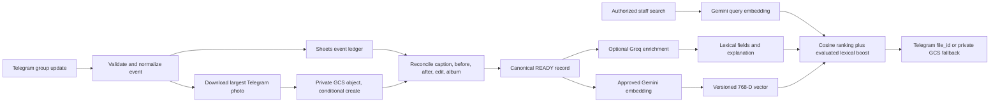
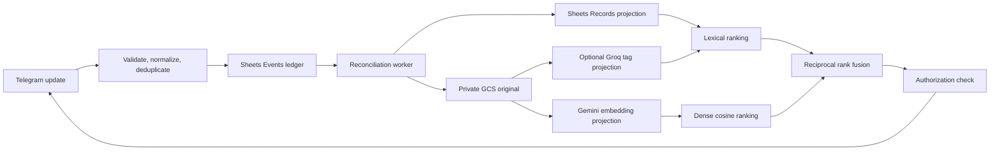

# Research Report: technical

**Date:** 2026-08-10
**Author:** Admin
**Research Type:** technical

---

## Research Overview

This research evaluates the Telegram school-photo workflow from message ingestion through protected ranked retrieval. It combines repository inspection, a local regression check, three independent Party Mode reviews, and current first-party documentation for Telegram, Google Apps Script, Google Cloud Storage, Gemini, Groq, and pgvector. The analysis separates local, staging, deployed, provider, and live evidence and treats children-image processing as a fail-closed governance boundary.

The central conclusion is to retain Apps Script for the bounded pilot while replacing synchronous webhook processing with a durable event ledger and asynchronous reconciliation. Private Google Cloud Storage should become the authoritative media store; Sheets should remain the event/catalog and operational projection; Gemini and Groq outputs should remain rebuildable derived data. The recommended semantic baseline is one 768-dimensional `gemini-embedding-2` vector combining the approved image and trusted teacher text, fused with lexical ranking. The free Gemini tier is limited to synthetic or properly de-identified material. See **Research Synthesis: From Telegram Message to Governed Semantic Archive** for the consolidated architecture, implementation roadmap, risk analysis, and acceptance gates.

---

<!-- Content will be appended sequentially through research workflow steps -->

## Technical Research Scope Confirmation

**Research Topic:** Telegram school-photo capture, AI enrichment, semantic retrieval, and long-term storage
**Research Goals:** Unbiasedly review the workflow from ingestion through ranked retrieval; verify Groq image-understanding and semantic-search roles; compare the easiest privacy-appropriate long-term storage options; distinguish repository, deployed, and live evidence.

**Technical Research Scope:**

- Architecture Analysis - design patterns, frameworks, system architecture
- Implementation Approaches - development methodologies, coding patterns
- Technology Stack - languages, frameworks, tools, platforms
- Integration Patterns - APIs, protocols, interoperability
- Performance Considerations - scalability, optimization, patterns

**Research Methodology:**

- Current web data with rigorous source verification
- Multi-source validation for critical technical claims
- Confidence level framework for uncertain information
- Comprehensive technical coverage with architecture-specific insights

**Scope Confirmed:** 2026-08-10

## Technology Stack Analysis

### Current Repository Stack

The repository implements a deliberately small serverless stack:

- Google Apps Script V8 JavaScript receives Telegram webhook updates.
- Telegram Bot API supplies photo variants, message/caption data, sender/chat provenance, reply data, and album identifiers.
- Google Drive stores the durable image copy.
- Google Sheets stores `Records`, ordered `Events`, and a separate `Embeddings` derived-data table.
- Groq's REST API optionally generates bilingual human-readable tags and captions outside the webhook path.
- Gemini Embedding 2 optionally maps approved images and text queries into one vector space for cosine ranking.
- Native Apps Script services provide locks, triggers, properties, Drive, Sheets, and HTTP calls; the runtime has no third-party package dependency.
- `clasp` manages the Apps Script project and a Node assert-based self-check exercises local logic.

The local `node tests/self_check.js` command passed on 2026-08-10. This is local logic proof only; it does not verify the deployed Apps Script version, Telegram webhook, Groq/Gemini calls, provider quality, or privacy approval.

### Programming Languages

Apps Script JavaScript is the appropriate primary language for the current low-volume archive because it already has native access to Drive, Sheets, time triggers, script properties, and locks. Moving ingestion to Python, Node.js hosting, containers, or Kubernetes would add deployment and credential management without addressing the current product risk: retrieval quality and privacy approval.

Apps Script is not unlimited. Google currently documents a six-minute execution limit, 20,000 daily URL Fetch calls and 90 minutes of daily trigger runtime for consumer accounts, 100,000 fetches and six trigger-hours for Workspace accounts, and a 50 MB URL Fetch response limit. Telegram's standard Bot API has the tighter photo-download ceiling of 20 MB. These limits support a small school archive if the webhook performs only capture and queueing while AI work stays in bounded background batches. [Google Apps Script quotas](https://developers.google.com/apps-script/guides/services/quotas), [Telegram Bot API `getFile`](https://core.telegram.org/bots/api#getfile)

_Primary language: Apps Script V8 JavaScript._  
_Additional runtime: Node.js only for the local self-check and `clasp` tooling._  
_Upgrade signal: measured webhook contention, exhausted trigger/fetch quotas, or unacceptable search latency—not speculative scale._  
_Confidence: High for documented limits and inspected local code; live utilization is unverified._

### Development Frameworks and Libraries

No application framework is warranted. Direct REST calls and native Apps Script services are the smallest compatible implementation:

- Telegram Bot API for webhook updates, file retrieval, reactions, and protected photo results.
- `DriveApp` and `SpreadsheetApp` for the archive and catalog.
- `UrlFetchApp` for Groq and Gemini REST calls.
- `LockService` for short critical sections and time-driven triggers for bounded enrichment.
- `clasp` for local source management and versioned deployment. [Google `clasp` guide](https://developers.google.com/apps-script/guides/clasp)

Telegram supports an `X-Telegram-Bot-Api-Secret-Token` webhook header, but the documented Apps Script `doPost(e)` event exposes query/path/body data and not arbitrary incoming headers. Consequently, the current query/path secret is an Apps Script compatibility workaround. Native header validation would require a header-aware ingress such as Cloud Run or a Function, which is not justified solely for this POC but remains a security trade-off. [Telegram `setWebhook`](https://core.telegram.org/bots/api#setwebhook), [Apps Script web requests](https://developers.google.com/apps-script/guides/web#request_parameters)

_Framework decision: retain native services; add no runtime dependency._  
_Confidence: High, with the header limitation being an inference from the two official interfaces._

### Image Understanding and Semantic Retrieval

Groq and embeddings perform different jobs and must not be conflated.

#### Groq vision enrichment

Groq currently documents `qwen/qwen3.6-27b` as its public multimodal vision model. It accepts image and text inputs, supports JSON object mode, and is suitable for captions, OCR, visible-object tags, and broader topic suggestions. It is a **Preview** model; Groq warns Preview models are evaluation-only and may be discontinued at short notice. Current published pricing is $0.60 per million input tokens and $3.00 per million output tokens, but the documentation is insufficient to derive a reliable per-photo price without measuring real token usage. [Groq vision documentation](https://console.groq.com/docs/vision), [Groq supported models](https://console.groq.com/docs/models)

The repository correctly uses one image per request, a small completion cap, JSON mode, local validation, bounded retries, and a configurable model ID. The schema should evolve to keep these meanings distinct:

- `observed_elements`: literally visible items such as `car`, `child`, or `woman`;
- `ocr_text`: text visibly present in the image;
- `literal_caption`: a conservative scene description;
- `inferred_topics`: associations such as `farm` inferred from `horse`, `sheep`, or `farmer`;
- uncertainty/confidence, language, provider/model, prompt/schema version, and processing timestamp.

JSON mode guarantees syntactically valid JSON, not strict field correctness or factual accuracy, so application validation and a representative Arabic/English quality benchmark remain mandatory. Groq's public API does not expose reusable text or image embeddings. Groq can improve lexical recall by generating words, but cannot by itself rank photos by semantic closeness. [Groq API reference](https://console.groq.com/docs/api-reference), [Groq structured outputs](https://console.groq.com/docs/structured-outputs)

Groq says inference inputs/outputs are not retained by default, but may be logged for reliability or abuse investigation for up to 30 days unless Zero Data Retention is enabled; usage metadata is always retained and retained customer data is located in US GCP buckets. These controls do not replace school consent, lawful processing, residency, subprocessor, and deletion approval. [Groq data controls](https://console.groq.com/docs/your-data)

#### Semantic ranking

Google documents stable `gemini-embedding-2` as a multimodal embedding model that maps text, images, video, audio, and PDFs into one space across more than 100 languages. This directly supports image-to-text search: index each image once, embed each query with the same model, and rank by cosine similarity. It supports flexible 128–3072 dimensions, with 768 recommended and already used by the repository. [Gemini Embedding 2 model](https://ai.google.dev/gemini-api/docs/models/gemini-embedding-2), [Gemini embeddings guide](https://ai.google.dev/gemini-api/docs/embeddings)

Current Gemini Developer API pricing lists image embedding at approximately $0.00012 per image on the paid standard tier and free use on the free tier. Google explicitly marks free-tier data as usable to improve its products and paid-tier data as not used for that purpose. Real school/children images therefore stay outside the free-tier path; any paid path still requires the school's explicit provider and privacy approval. [Gemini Developer API pricing](https://ai.google.dev/gemini-api/docs/pricing)

_Technology decision: Groq for optional readable enrichment; one separate multimodal embedding model for semantic ranking; lexical fallback retained._  
_Confidence: High for documented capabilities; Low for real bilingual relevance and image-quality claims until a live, approved benchmark is run._

### Database and Storage Technologies

Object storage and semantic search are separate concerns. Moving photos to a cheaper bucket does not make them searchable by meaning; captions, provenance, derived tags, embeddings, and authorization still require a catalog/index.

#### Current Drive + Sheets design

Drive is operationally easiest because Apps Script can create and read private files natively, administrators can browse the archive, and the bot can retain a durable copy while using Telegram's persistent `file_id` for efficient result delivery. Drive files may expose recognized image metadata, but Telegram photo processing does not guarantee original filename, MIME type, EXIF, or GPS preservation. `file_unique_id`, Drive checksum/size/MIME when available, and Telegram/Drive identifiers should therefore be stored separately. [Telegram `PhotoSize`](https://core.telegram.org/bots/api#photosize), [Google Drive File resource](https://developers.google.com/workspace/drive/api/reference/rest/v3/files)

Sheets supports 10 million cells, which is ample for a small one-row-per-photo catalog, although full-sheet scans and serialized vectors will become slow before the hard cell ceiling. Drive search supports names, labels, and exact custom properties, not semantic vector similarity; Sheets or a later database remains the search index. [Google Drive and Sheets limits](https://support.google.com/drive/answer/37603), [Google Drive search](https://developers.google.com/workspace/drive/api/guides/search-files)

The best long-term ownership variant is a restricted, institution-owned Google Workspace for Education Shared Drive if the school qualifies. Google currently lists Education Fundamentals at no cost for qualifying institutions with 100 TB pooled storage; eligibility and account governance must be confirmed. Shared-drive files belong to the organization instead of an individual teacher or freelancer. [Workspace for Education editions](https://edu.google.com/workspace-for-education/editions/compare-editions/), [Education eligibility](https://support.google.com/a/answer/134628)

#### Storage alternatives

| Option | Current public allowance/cost snapshot | Strength | Added cost/complexity | Fit now |
|---|---|---|---|---|
| Institution-owned Drive/Shared Drive | Education Fundamentals may provide 100 TB pooled at no cost to qualifying schools | Native Apps Script access, human browsing, organizational ownership | Eligibility, Workspace governance, Drive API policy review | **Best fit if eligible** |
| Consumer Drive | 15 GB shared across Drive/Gmail/Photos; paid plans are location-dependent | Already integrated; simplest POC | Individual ownership and shared quota are poor long-term governance | POC only |
| Google Cloud Storage Standard | 5 GB-month Always Free in three US regions; typical single-region storage is about $0.020/GiB-month plus operations/egress | IAM, lifecycle, retention, versioning, signed URLs; Google ecosystem | Billing, region choice, OAuth/service account, and signed-URL code | Best object-store fallback |
| Cloudflare R2 Standard | 10 GB-month free; then $0.015/GB-month, free Internet egress, metered operations | Portable S3 API and cheap frequent retrieval | AWS Signature V4 or a Worker/proxy; storage has no semantic index | Future egress-heavy option |
| Backblaze B2 | First 10 GB free; current headline starts at $6.95/TB-month; egress free up to 3x stored volume | Lowest raw storage cost and S3 portability | Extra provider/auth workflow; limited S3 object tagging and bucket-level ACL model | Future cost-led archive option |
| Supabase Storage + Postgres/pgvector | Free: 1 GB storage and paused inactive projects; Pro starts at $25/month with 100 GB storage | Integrated relational metadata, RLS, and vector similarity search | Much higher fixed cost and a new database/auth/backup system | Defer until Sheets is measured insufficient |

Sources: [Google Cloud Storage pricing](https://cloud.google.com/storage/pricing), [Cloudflare R2 pricing](https://developers.cloudflare.com/r2/pricing/), [Backblaze B2 pricing](https://www.backblaze.com/cloud-storage/pricing), [Supabase pricing](https://supabase.com/pricing), [Supabase vector columns](https://supabase.com/docs/guides/ai/vector-columns).

_Storage decision: do not migrate merely for cheaper GB-month pricing. Confirm institutional Shared Drive first; use Google Cloud Storage if object lifecycle, region, IAM, or retention controls justify migration. Consider B2/R2 only when measured cost or egress dominates. Consider Supabase only when a real database/vector index is already needed._  
_Confidence: High on current public prices/capabilities; Medium on school eligibility, regional terms, and the best provider until archive size and access pattern are measured._

### Development Tools and Platforms

The minimum toolchain is sufficient:

- `clasp` for source pull/push, Apps Script versions, and deployments;
- Node.js for the framework-free self-check;
- the Apps Script execution dashboard for quota/error observation;
- Telegram `getWebhookInfo` for pending delivery and webhook errors;
- provider consoles for actual model availability, limits, spend, and retention settings.

No test framework is required yet, but the single runnable self-check must continue to fail on broken parsing, normalization, idempotency, privacy gating, vector validation, and deterministic ranking. Live proof must separately exercise a new group photo, stored Drive/Sheets record, approved provider enrichment, synonym/visible-element search, and authorized result delivery.

### Cloud Infrastructure and Deployment

Apps Script is the correct serverless host at current volume, with three boundaries:

1. return from the Telegram webhook after capture/queueing rather than waiting for AI;
2. keep locks around only short shared-state mutations;
3. batch external AI work below trigger-runtime and provider-rate limits.

A header-aware Cloud Run/Function ingress becomes justified if native Telegram secret-header validation, stricter network controls, queue durability, or measured concurrency demands it. A vector database becomes justified when exact in-memory/Sheet cosine scans miss the measured search-latency target. Containers and Kubernetes have no current justification.

_Deployment decision: retain Apps Script; define measurable upgrade thresholds._  
_Confidence: High for the low-volume architecture; live throughput and failure rate remain unmeasured._

### Technology Adoption Trends

Three current platform trends affect this design:

- Multimodal embedding APIs now directly support cross-language image-to-text retrieval, reducing the need to pretend generated tags are semantic vectors.
- S3-compatible object stores make later photo migration portable, but their low storage prices do not remove the need for metadata, authorization, and a search index.
- Hosted model catalogs change quickly. Groq's public vision option is currently Preview, so original Telegram/Drive data must remain provider-neutral and all derived enrichment must be versioned and rebuildable.

The evidence supports incremental evolution: preserve the simple native archive, improve the data contract and live proof first, and add infrastructure only at a measured limit.

### User-Selected Stack Direction

On 2026-08-10, the user selected Google Cloud Storage as the target durable image archive and `gemini-embedding-2` on the Gemini Developer API free tier for the semantic pilot.

Because Google's current pricing documentation marks free-tier data as usable to improve Google products, this choice is accepted for synthetic or properly de-identified pilot images only. Processing identifiable school or children's images remains gated on explicit school privacy approval and an appropriate provider/data-processing arrangement. The integration analysis must keep original capture/storage available when semantic processing is disabled or rejected.

## Integration Patterns Analysis

### Integration Verdict

The selected stack is technically coherent if its responsibilities remain separate:

- Telegram is the capture and delivery channel.
- Google Cloud Storage is the private durable object archive.
- Sheets is the canonical catalog, event ledger, processing queue, and small-pilot vector store.
- Gemini Embedding 2 owns cross-modal semantic similarity.
- Groq vision produces optional, untrusted descriptive metadata and lexical expansion; it does not own the vector space.

The current implementation is a useful POC but does not yet meet the full message-association contract. It combines a photo caption and a following text line in one field, ignores edited messages and forum topics, treats albums as unrelated photos, and assumes webhook arrival order equals message order. Those are correctness defects to resolve before any storage migration is called complete.



### API Design Patterns

#### Telegram ingress contract

The webhook should accept `message` and `edited_message` updates, validate the configured school group, normalize the update into an internal event, record it idempotently, and return promptly. Telegram retries non-successful webhook calls and exposes `update_id` to recover order; application processing must therefore be retry-safe rather than assuming exactly-once delivery. [Telegram Bot API](https://core.telegram.org/bots/api)

The supplied private-group value is an invite link. It is neither the bot identity nor the numeric Telegram `chat_id`. Installation must separately confirm the bot username and explicitly configure the numeric school group ID. The existing first-group auto-binding behavior is too permissive for a real school deployment.

Telegram group privacy mode must be disabled or the bot must be an administrator so it receives ordinary teacher photos and adjacent text. Authorization still belongs in the backend; Telegram command visibility or group membership alone is not authorization. [Telegram bot privacy mode](https://core.telegram.org/bots/features#privacy-mode)

#### Google Cloud Storage object API

Use the Cloud Storage JSON API directly from Apps Script with a short-lived token from `ScriptApp.getOAuthToken()`. This is the least-code option for a web app deployed as the stable school-owned account and avoids storing a service-account private key or adding an OAuth library. The manifest needs the existing external-request scope plus `https://www.googleapis.com/auth/devstorage.read_write`; bucket IAM remains the actual authorization boundary. [Apps Script OAuth token](https://developers.google.com/apps-script/reference/script/script-app#getoauthtoken), [Cloud Storage OAuth scopes](https://docs.cloud.google.com/storage/docs/oauth-scopes)

Create each object with a deterministic opaque name such as `telegram/<numeric-chat-id>/<message-id>/<photo-index>.jpg` and a media upload using `ifGenerationMatch=0`. The upload then succeeds only when no live object already has that name; a duplicate webhook produces `412 Precondition Failed` instead of silently overwriting data. On `412`, read the existing object metadata and accept it only when size and checksum match. [Cloud Storage request preconditions](https://docs.cloud.google.com/storage/docs/request-preconditions), [Objects: insert](https://docs.cloud.google.com/storage/docs/json_api/v1/objects/insert)

Supply an MD5 integrity header for this single-request upload because Apps Script can calculate MD5 natively, while retaining Cloud Storage's returned CRC32C, MD5, generation, size, and content type in the catalog. Cloud Storage assigns a unique immutable generation to every object and computes CRC32C for every object. [Cloud Storage object metadata](https://docs.cloud.google.com/storage/docs/metadata), [Cloud Storage data validation](https://docs.cloud.google.com/storage/docs/data-validation)

For result delivery, prefer Telegram's bot-specific persistent `file_id`. If that fails, fetch the exact recorded GCS object generation over authenticated HTTPS and upload the returned blob to Telegram. Do not create public objects or signed URLs: the bot is the authorization boundary, and signed URLs are bearer links unnecessary for server-to-server delivery. [Cloud Storage Objects: get](https://docs.cloud.google.com/storage/docs/json_api/v1/objects/get), [Cloud Storage signed URLs](https://docs.cloud.google.com/storage/docs/access-control/signed-urls)

#### Gemini Embedding 2 API

Create one 768-dimensional embedding per photo record using one `Content` containing the image and the trusted teacher text (`caption`, `before_line`, and `after_line`). Google documents that multiple parts in one content produce one aggregated embedding. This is the smallest post-level representation and captures both visible elements and teacher context without multiplying provider calls. [Gemini embeddings guide](https://ai.google.dev/gemini-api/docs/embeddings), [Gemini Embedding 2 model](https://ai.google.dev/gemini-api/docs/models/gemini-embedding-2)

Do not initially include Groq-generated words in this trusted vector. A hallucinated Groq tag would then distort the main semantic representation. Store Groq outputs separately and test them as a lower-weight lexical boost or explanatory match reason. If experiments later justify a tag embedding, give it a separate `embedding_kind` and score rather than silently changing the base-vector meaning.

Embed queries with the same stable model, 768 dimensions, and a frozen recipe version. Google recommends the text prefix `task: search result | query: {content}` for text retrieval, but its benefit for text-to-image-plus-text retrieval is not established; compare prefixed and plain queries on the pilot evaluation set before freezing the recipe. Gemini Embedding 2 does not support the older `task_type` field. [Gemini task instructions](https://ai.google.dev/gemini-api/docs/embeddings#task-types)

#### Groq vision API

Groq should return a versioned, application-validated object with distinct meanings, for example:

```json
{
  "observed_elements": ["horse", "child"],
  "ocr_text": [],
  "literal_caption": "A child near a horse",
  "inferred_topics": ["farm"],
  "related_lexical_terms": ["farmer", "sheep"]
}
```

The separation prevents `farm` from being represented as literally visible when it is only a semantic association. Groq JSON mode provides JSON syntax, not factual correctness or strict schema compliance, so local validation, provenance, and bounded retries remain mandatory. Groq is optional: storage, teacher metadata, and semantic retrieval must remain operable when Groq is disabled. [Groq vision](https://console.groq.com/docs/vision), [Groq structured outputs](https://console.groq.com/docs/structured-outputs)

### Communication Protocols

All integrations can remain HTTPS REST calls from Apps Script; no new framework, queue service, database, or signed-URL service is required for the small pilot.

- Telegram pushes JSON webhook updates. `getUpdates` and webhooks are mutually exclusive.
- Apps Script downloads the largest Telegram `PhotoSize` using `getFile`; the standard Bot API currently limits downloads to 20 MB and the temporary URL is valid for at least one hour.
- Apps Script uploads/downloads raw image bytes to/from GCS over OAuth-authenticated JSON API requests.
- Apps Script sends JSON plus inline base64 image data to Gemini and Groq only in approved background work.
- Time-driven triggers process bounded batches so provider latency and throttling do not block the Telegram webhook.

Provider calls must occur outside shared locks. Retry only timeouts, `408`, `429`, and `5xx` responses with bounded exponential backoff and jitter through later trigger runs. Do not sleep through long backoff intervals in Apps Script, and do not repeatedly retry deterministic `400`, `401`, or `403` configuration/data failures. On query-embedding failure, fall back immediately to a clearly labeled lexical result set. [Gemini troubleshooting](https://ai.google.dev/gemini-api/docs/troubleshooting), [Cloud Storage retry strategy](https://docs.cloud.google.com/storage/docs/retry-strategy)

### Data Formats and Standards

The current `after_line_caption` field must be split. Caption text belongs to the photo message and can appear visually above or below the media; it is not a following Telegram message. A record needs at least these groups:

| Group | Minimum fields |
|---|---|
| Telegram identity | `record_id`, `update_id`, `chat_id`, `message_id`, `message_thread_id`, `media_group_id`, `file_id`, `file_unique_id` |
| Attribution | `sender_id`, `sender_type`, `sender_chat_id`, `message_date`, `edit_date` |
| Human context | separate `caption`, `before_line`, `after_line`, `reply_to_message_id`, `association_method`, `association_confidence` |
| Photo facts | selected photo index, width, height, Telegram file size, downloaded MIME type when known |
| GCS identity | bucket, object name, generation, metageneration, size, MD5, CRC32C, content type |
| Processing | capture/reconcile/tag/embed state, attempt count, lease, last error, timestamps |
| Derived AI | provider, model, prompt/schema version, observed elements, OCR, inferred topics, processing time |
| Embedding | model, dimensions, recipe version, content hash, vector state, vector, source object generation |

Keep the image and teacher-provided text as source data; treat tags, captions produced by AI, and embeddings as rebuildable derived data. Telegram's `getFile` may not preserve the original filename or MIME type, and Telegram does not promise original EXIF/GPS preservation. Do not claim metadata that the platform did not provide. [Telegram `getFile`](https://core.telegram.org/bots/api#getfile)

The embedding uniqueness key should be:

```text
record_id + embedding_kind + model + dimensions + recipe_version
```

Also store a SHA-256 `content_hash` over the image identity/bytes, normalized trusted text, model, dimensions, and recipe version. A `READY` vector is reusable only when the hash still matches. This prevents caption edits or corrected associations from leaving a stale vector. Validate every response for exactly 768 finite values and a nonzero norm before replacing the previous valid vector.

### System Interoperability Approaches

GCS must remain the object store, not the search database. Keep captions, associations, tags, consent state, processing status, and vectors in Sheets during the bounded pilot. Avoid duplicating those fields into GCS custom metadata: it adds update permission and synchronization work without providing semantic retrieval.

The interoperability keys are deliberately provider-neutral:

- `record_id` links Telegram, the catalog, derived tags, and embeddings;
- `(bucket, object_name, generation)` identifies the exact durable bytes;
- `file_id` is the fast Telegram delivery handle;
- `file_unique_id` helps identify Telegram-equivalent media but cannot download a file;
- model, prompt/schema, recipe, and source-generation fields make all derived data auditable and rebuildable.

Exact cosine scanning in Apps Script/Sheets is acceptable for the approved 100-photo pilot. A vector database is an upgrade only after measured search latency or record volume exceeds the agreed target. Storage migration to GCS does not itself improve semantic search.

### Microservices Integration Patterns

Do not split the POC into microservices. Retain one Apps Script project with small logical boundaries and external provider adapters:

- `capture`: validate, normalize, ledger, Telegram download, conditional GCS upload;
- `reconcile`: rebuild caption/before/after/album associations from ordered events;
- `enrich`: optional Groq work;
- `embed`: gated Gemini work;
- `search`: authorize, embed query, rank, deliver;
- `admin`: approvals, re-indexing, retention/deletion, and health checks.

Use persisted states rather than an in-memory transaction across Telegram, GCS, Sheets, and AI providers:

```text
CAPTURE_PENDING -> STORED -> RECONCILED
                         -> TAG_PENDING -> TAGGED | TAG_ERROR
                         -> EMBED_PENDING -> EMBEDDING -> READY | EMBED_ERROR
READY -> REINDEX_PENDING when trusted text, image generation, or recipe changes
ANY -> REVOKED when consent/access is withdrawn
```

Remote work happens outside locks; locks protect only short claim/commit mutations. On an enrichment failure, retain the original photo and last valid derived record. The semantic and Groq branches are independent so one provider outage cannot block capture or the other branch.

### Event-Driven Integration

The event ledger should be authoritative for reconciliation rather than mutating a single record based only on webhook arrival order:

1. Deduplicate on Telegram `update_id` and store the normalized event.
2. For photo bytes, create the deterministic GCS object with `ifGenerationMatch=0`.
3. Reconcile events by chat, thread, and Telegram `message_id` after a small bounded settling window.
4. Make the photo caption and an explicit reply authoritative.
5. Use adjacency only as a same-sender, same-thread, bounded-time heuristic and record the association method/confidence.
6. Propagate shared context across photos with the same `(chat_id, media_group_id)` while retaining one object and record per photo.
7. Reconcile `edited_message` into the source record, recompute the content hash, and queue re-enrichment/re-embedding.

This corrects the present gaps: a caption no longer blocks a following line; late/out-of-order events can be reconciled; cross-topic association is prevented; edits invalidate stale vectors; and album members receive shared context. The current self-check does not exercise any of these live-provider behaviors, so they require new deterministic fixtures plus deployed evidence.

### Integration Security Patterns

#### Ingress and Telegram authorization

Telegram supports `X-Telegram-Bot-Api-Secret-Token`, but the documented Apps Script `doPost(e)` event does not expose arbitrary incoming headers. The existing high-entropy query/path secret is therefore an Apps Script compatibility compromise, not equivalent native header verification. Retain it for this POC, rotate it if exposed, and move only the ingress to a header-aware Cloud Run/Function if native header validation becomes a mandatory control. [Telegram `setWebhook`](https://core.telegram.org/bots/api#setwebhook), [Apps Script request fields](https://developers.google.com/apps-script/guides/web#request_parameters)

Disable automatic first-group binding. Require the explicit numeric school `chat_id`, a fixed allowlist of adult staff Telegram user IDs, and preferably a live `getChatMember` check before returning private search results. Telegram does not provide age verification, so the school must administratively attest that approved search users are adult staff. Send results with Telegram content protection enabled where supported.

#### GCS access control

Use a school-owned standard Google Cloud project and a private Standard bucket with uniform bucket-level access and public access prevention. Grant the deploying account bucket-scoped `roles/storage.objectCreator` plus `roles/storage.objectViewer` for normal immutable upload/read. This is narrower than Storage Admin and prevents the bot from deleting or replacing archives. Use a separate admin-approved identity/workflow with `roles/storage.objectUser` only when deletion is required. [Uniform bucket-level access](https://docs.cloud.google.com/storage/docs/uniform-bucket-level-access), [Public access prevention](https://docs.cloud.google.com/storage/docs/public-access-prevention), [Cloud Storage IAM roles](https://docs.cloud.google.com/storage/docs/access-control/iam-roles)

Choose the school-approved residency region before price. GCS Always Free currently covers 5 GB-months plus operation allowances only in `us-west1`, `us-central1`, and `us-east1`; it is not a reason to place children's photos in the US. GCS also offers Doha, Dammam, Tel Aviv, and Johannesburg regions, but institutional/legal approval controls the choice. [Cloud Storage free tier](https://docs.cloud.google.com/free/docs/free-cloud-features), [Cloud Storage locations](https://docs.cloud.google.com/storage/docs/bucket-locations)

#### Provider and secret controls

Store the Telegram, Groq, and Gemini secrets in Script Properties, never Sheets, logs, URLs shown to users, or the repository. The GCS OAuth token is short-lived and must never leave server-side Apps Script. Record provider/model/version and approval state, not API keys.

The free Gemini tier is a hard governance boundary, not merely a budget option. Google's terms say unpaid-service input/output may be used to improve products, may be processed by human reviewers, and must not contain sensitive, confidential, or personal information. They also prohibit API clients directed toward or likely accessed by under-18s. Therefore:

- synthetic or properly de-identified images may enter the explicitly gated free-tier pilot;
- identifiable school/children photos must not enter the Gemini free tier;
- the user-facing bot stays adult-staff-only;
- real-photo Gemini use requires an active billing project plus explicit school/privacy/provider approval, noting that paid service still has limited abuse/safety/legal logging.

Current Gemini pricing lists Gemini Embedding 2 text and image input as free on the standard free tier and about $0.00012 per image on the paid standard tier. Actual free-tier rate limits are project-specific, visible in Google AI Studio, applied per project rather than per API key, and not guaranteed. The trigger must read configured batch limits and fail closed rather than hardcoding a published quota. [Gemini pricing](https://ai.google.dev/gemini-api/docs/pricing), [Gemini terms](https://ai.google.dev/gemini-api/terms), [Gemini rate limits](https://ai.google.dev/gemini-api/docs/rate-limits)

Groq receives real photos only under its own separately approved processing gate. A Gemini approval does not automatically approve Groq, and vice versa.

#### Retention, recovery, and deletion

New GCS buckets have seven-day soft delete by default. Soft-deleted bytes remain retained and billed until the retention period expires and cannot be permanently purged early. Decide before launch whether that recovery window matches the school's deletion promise; disable soft delete before processing relevant data if contractual erasure must be immediate. Leave Object Versioning off unless a measured need appears, and do not lock a bucket retention policy before legal/privacy approval because a locked policy cannot be shortened. [Cloud Storage soft delete](https://docs.cloud.google.com/storage/docs/soft-delete), [Object Versioning](https://docs.cloud.google.com/storage/docs/object-versioning), [Bucket Lock](https://docs.cloud.google.com/storage/docs/bucket-lock)

A deletion workflow must target the recorded object generation with a generation-match precondition and also tombstone/purge the human metadata, Groq fields, embedding, caches, and Telegram delivery handles. Deleting only the GCS object does not erase the searchable personal-data record. Use lifecycle rules only after the school approves the retention period. [Cloud Storage lifecycle](https://docs.cloud.google.com/storage/docs/lifecycle)

### Recommended Search and Failure Contract

For each authorized query:

1. Normalize the Arabic/English query and enforce length/content limits.
2. If the approved Gemini gate is active, create the query vector with the exact stable model, 768 dimensions, and recipe cohort.
3. Compare only current `READY` rows from that same model/dimension/recipe and current source generation.
4. Rank by cosine similarity. Evaluate, rather than invent, any lexical boost from teacher text or Groq fields on a labeled Arabic/English benchmark.
5. Return a bounded top set with the matched teacher text and/or a transparent reason such as visible element, inferred topic, or semantic similarity.
6. If Gemini is unavailable, use the labeled lexical fallback; do not pretend it is semantic ranking.
7. Deliver with Telegram `file_id`, falling back to authenticated exact-generation GCS retrieval.

The acceptance benchmark should include literal elements (`car`, `child`, `woman`), inferred topics (`farm` from horse/sheep/farmer), Arabic/English variants and synonyms, captions plus both adjacent-line positions, edited captions, albums, same-sender messages in different topics, false-association negatives, quota failures, replayed webhooks, revoked users, and deleted records.

### Integration Recommendation

Proceed with GCS migration and the Gemini Embedding 2 pilot only as two independently gated changes:

- **GCS archive:** suitable for real photos after the school approves bucket ownership, region, retention, IAM, and deletion behavior.
- **Gemini free-tier semantic pilot:** suitable only for synthetic or properly de-identified photos. It cannot be represented as a production path for identifiable children images.

Keep lexical search and original capture available whenever AI is disabled. Before implementation, fix the caption/after-line collision and define edit, album, thread, and event-order reconciliation. No live Telegram, GCS, Gemini, or Groq behavior has been proven by this research; all provider and deployed claims remain pending explicit setup and end-to-end tests.

## Architectural Patterns and Design

### System Architecture Patterns

#### Recommended pattern: serverless modular monolith with a durable event ledger

For one small school and a 100-photo semantic pilot, retain one Apps Script project and separate the workflow by persisted stages rather than deployable microservices:

```text
Telegram webhook
  -> validate configured group and append/deduplicate raw update
  -> acknowledge
Time trigger
  -> reconcile ordered Telegram events
  -> fetch photo and conditionally create immutable GCS object
  -> materialize canonical photo record
Independent triggers
  -> optional Groq projection
  -> approved Gemini embedding projection
Authorized search
  -> dense + lexical retrieval
  -> Telegram file_id or authenticated GCS fallback
```

The webhook should no longer hold the global lock across Telegram, Drive/GCS, provider, and Sheet network operations. It should take a short script lock only to append or deduplicate the update, then return. A worker trigger can call Telegram `getFile` later from the recorded `file_id`; Telegram states that the generated file URL lasts at least one hour, while a fresh URL can be requested again from the persistent `file_id`. This turns webhook delivery into a durable inbox rather than a synchronous distributed transaction. [Telegram `getFile`](https://core.telegram.org/bots/api#getfile), [Apps Script Lock Service](https://developers.google.com/apps-script/reference/lock)

This is a modular monolith, not an unstructured monolith. Capture, reconciliation, storage, enrichment, indexing, search, and administration have explicit contracts and states, but stay in one deployment until independent scaling or security boundaries are measured. Google Cloud's current architecture guidance recommends starting simple, using managed services, resisting over-engineering, and decoupling components where independence creates concrete value. [Google Cloud Well-Architected Framework](https://docs.cloud.google.com/architecture/framework)

#### Alternatives and trade-offs

| Pattern | Benefits | Costs and remaining problems | Decision |
|---|---|---|---|
| **A. Apps Script + Sheets ledger/triggers + GCS** | Fewest services and credentials; native Sheets/admin workflow; versioned web-app deployment; enough for one low-volume school | Six-minute executions and trigger quotas; query/path webhook secret; Sheets scan/lock ceiling; reconciliation must be implemented | **Use now** |
| **B. Apps Script ingress + Cloud Tasks/Cloud Run worker** | Rate-controlled enrichment, longer workers, independent worker scaling and IAM | Apps Script still cannot verify Telegram's secret header; enqueue introduces another dual-write/failure boundary; Cloud Tasks is at-least-once and unordered, so idempotency/reconciliation remain mandatory | Use when worker backlog or quotas are measured constraints |
| **C. Full Cloud Run ingress/workers + managed queue/database** | Native Telegram header validation, better isolation/observability, independent scaling, future tenant boundaries | Highest IAM, deployment, database, queue, operations, and cost complexity; still needs idempotency and Telegram-event reconciliation | Reserve for a mandated security control, contractual SLO, or multiple schools |

Cloud Tasks is useful for non-interactive asynchronous work and rate control, but documents at-least-once delivery and requires idempotent handlers. Adding a queue would not create message order or exactly-once execution. [Cloud Tasks overview](https://docs.cloud.google.com/tasks/docs/dual-overview)

#### Proposed architectural decision gates

These are project guardrails, not provider-published limits:

- Stay on A while capture success is at least 99.5%, the oldest eligible background job clears within 15 minutes, lock failures stay below 0.1% of updates, and search remains within the agreed latency target.
- Move background work from A to B after any recurring six-minute termination, seven-day average trigger-runtime consumption above 70% of the account quota, sustained enrichment backlog older than 15 minutes, or provider rate control becomes operationally unreliable.
- Move ingress to C if policy requires Telegram's official secret header, if a 99.9% ingestion SLO becomes contractual, or if multiple schools require tenant-isolated data/identities.
- Move catalog/search from Sheets to a database when measured latency, concurrent access, filtering/authorization requirements, or active-vector count crosses the retrieval gates below.

Apps Script currently documents six minutes per execution, account-specific daily trigger runtime, and 50 MB URL Fetch request/response limits. Quotas can change and must be monitored in the real account. [Apps Script quotas](https://developers.google.com/apps-script/guides/services/quotas)

### Design Principles and Best Practices

#### Source data is authoritative; AI output is disposable

The durable source record consists of Telegram provenance, teacher-provided text, and the exact GCS object generation. Groq captions/tags and Gemini vectors are projections that can be rebuilt. No provider output may silently overwrite teacher text or become the only representation of a photo.

#### Idempotency before retries

Every externally visible write needs an application idempotency key:

- Telegram event: `update_id`;
- photo record: `chat_id:message_id:photo_index`;
- GCS object: deterministic name plus `ifGenerationMatch=0`;
- Groq projection: record + provider/model + prompt/schema + source content hash;
- Gemini projection: record + embedding kind/model/dimensions/recipe + source content hash.

Cloud Storage generation preconditions prevent retries and races from overwriting or deleting an unintended object. [Cloud Storage preconditions](https://docs.cloud.google.com/storage/docs/request-preconditions)

#### Persist progress rather than pretending there is one transaction

Telegram, Sheets, GCS, Groq, and Gemini cannot participate in a shared transaction. Use explicit states and compensating behavior:

- capture failure leaves a retryable ledger event;
- GCS success plus Sheet commit failure is recovered by deterministic object lookup/checksum;
- provider failure leaves the previous valid derived value and a retryable/error state;
- approval revocation immediately excludes the record from processing/search, followed by asynchronous purge;
- deletion targets the recorded generation and tombstones every searchable projection.

#### Fail closed at privacy and authorization boundaries

Missing approval means no external AI call. Missing or stale user authorization means no result. Invalid vector cohort, dimension, content hash, or source generation means the row is ineligible, not approximately acceptable.

#### Keep decisions explicit and reversible

Record short architectural decision records for bucket region, soft-delete setting, staff authorization source, free-versus-paid Gemini boundary, Groq approval, vector recipe, and upgrade gates. Model and recipe migrations build a new cohort beside the active one, evaluate it, then switch one active-cohort setting. The old cohort is retained only for a short approved rollback period.

### Scalability and Performance Patterns

#### Isolate interactive work from background work

The Telegram webhook should perform validation and the minimum durable append only. Photo download/storage, reconciliation, Groq, and Gemini belong in bounded trigger batches. Search remains interactive but degrades to lexical results if query embedding fails. This reduces retry amplification and protects capture during provider outages. Google SRE guidance recommends bounded retries with randomized exponential backoff and jitter and warns that retries at multiple layers can multiply overload. [Google SRE: Addressing Cascading Failures](https://sre.google/sre-book/addressing-cascading-failures/)

#### Short critical sections

Locks protect only the minimal read/check/append or lease/commit operation. External HTTP calls and GCS transfers happen outside locks. A worker claims a bounded set with a lease, performs remote work, then reacquires the lock to validate the lease/content hash and commit.

#### GCS fast and recovery paths

Cloud Storage gives strongly consistent object read-after-write and atomic individual-object uploads, so a successful upload can be fetched immediately. Record the generation returned by the write and use it for later reads/deletes. [Cloud Storage consistency](https://docs.cloud.google.com/storage/docs/consistency)

Telegram `file_id` remains the normal result-delivery path because it avoids a GCS download and Telegram re-upload. GCS exact-generation retrieval is the recovery path, not a public media CDN.

#### Search architecture

Use one 768-dimensional aggregated vector per approved photo for the baseline: image plus trusted teacher caption/before/after text. Batch-read eligible vectors once, compute exact cosine in memory, and keep Groq fields out of the base vector.

Produce two ranked lists:

- dense: cosine similarity over the active Gemini cohort;
- lexical: exact phrase/token matches over trusted text and optional Groq fields.

Fuse ranks using Reciprocal Rank Fusion instead of adding raw cosine and lexical scores, because those scores have incompatible scales. Evaluate semantic-heavy and balanced variants; do not choose weights by intuition. Google's current hybrid-search documentation also uses RRF to combine dense and sparse result ranks. [Google hybrid search and RRF](https://docs.cloud.google.com/gemini-enterprise-agent-platform/build/vector-search/about-hybrid-search)

Evaluate these alternatives without permanently indexing all of them:

1. image-only vector;
2. aggregated image + trusted text vector;
3. separate image and trusted-text vectors with late fusion.

Promote the more complex separate-vector design only after a predeclared material quality gain, such as at least five percentage points in Recall@5 on the approved evaluation set.

#### Retrieval scaling guardrails

These are engineering planning thresholds, not Google limits:

| Active vectors | Architectural action |
|---:|---|
| 100-1,000 | Sheets exact cosine is appropriate |
| 1,000-5,000 | Benchmark each size doubling; one bulk Sheet read, in-memory calculation |
| Above 5,000 | Prepare database/vector migration, especially if using multiple vectors per photo |
| Above 10,000 or p95 search above two seconds | Move retrieval out of Apps Script/Sheets |
| Any size with concurrent schools, row-level ACL filters, or sustained bursts | Move earlier |

When migration is justified, start with exact vector search in PostgreSQL/pgvector and add approximate indexing only when exact latency fails the target. Approximate search trades recall for speed and must be compared against an exact ground truth. [pgvector documentation](https://github.com/pgvector/pgvector), [Google Vector Search concepts](https://docs.cloud.google.com/gemini-enterprise-agent-platform/build/vector-search/overview)

### Integration and Communication Patterns

#### Durable inbox plus materialized projection

The event ledger is an append-oriented inbox of normalized Telegram updates. `Records` is a materialized projection rebuilt/reconciled from that ledger. This is the key pattern for out-of-order updates, edits, replies, topics, and albums:

- order by Telegram `update_id` for delivery analysis and by `(chat_id, message_thread_id, message_id)` for message adjacency;
- preserve both `message` and `edited_message` variants;
- make caption and explicit reply authoritative;
- treat adjacency as a same-sender, same-thread, bounded-time heuristic with a recorded confidence/method;
- propagate shared text across `(chat_id, media_group_id)` without collapsing individual photo objects.

Serializing webhook arrival with `max_connections: 1` or one global lock does not reconstruct Telegram semantics and should not substitute for reconciliation.

#### Provider adapters with independent circuits

Telegram, GCS, Groq, and Gemini each need a small adapter that owns request construction, response validation, error classification, and provider-specific provenance. The domain record sees normalized values, not provider response shapes.

Groq and Gemini have separate processing states, approval gates, retry budgets, and disable switches. Turning Groq off must not affect capture or Gemini. Turning Gemini off must preserve lexical search. A provider-wide run of `429`/`5xx` responses opens that provider's circuit until a later scheduled attempt instead of consuming the entire Apps Script runtime.

#### Queue upgrade pattern

If Cloud Tasks is later introduced, write the durable job state first, then enqueue a task containing only the stable job ID. A sweeper finds claimed/pending jobs that were not successfully enqueued or completed. The task handler rechecks current approval, content hash, and state because delivery can repeat and timing is not guaranteed. [Cloud Tasks overview](https://docs.cloud.google.com/tasks/docs/dual-overview)

### Security Architecture Patterns

#### Trust zones

1. **External ingress:** Telegram webhook input is untrusted JSON and file identifiers.
2. **School control plane:** Apps Script, Sheets, Script Properties, and the standard Google Cloud project hold authorization/configuration.
3. **Private object plane:** GCS stores exact image bytes with public access prevention and uniform bucket-level IAM.
4. **External AI processors:** Groq and Gemini receive only records that pass their separate approval/data-use gates.
5. **Staff delivery:** Search results return only after adult-staff authorization and current group-membership checks.

Every result request performs object-level and function-level authorization; knowing a record ID, command, or GCS name never grants access. OWASP's API security guidance places broken object authorization, broken authentication, and unrestricted resource consumption among the principal API risks. [OWASP API Security Top 10](https://owasp.org/API-Security/editions/2023/en/0x11-t10/)

#### Least privilege and separation of duties

The normal bot deployment gets bucket-scoped object create/read permissions, not bucket administration or object deletion. A separate school-approved administrative identity/workflow performs generation-matched deletion. Bucket-region, public-access prevention, uniform access, soft-delete, and lifecycle settings are infrastructure administration, not runtime bot commands.

Use a school-owned standard Cloud project and stable institutional deployment account. Add more than one institutional administrator so the system does not fail when one person's account is removed; Apps Script warns that versioned deployments retain their owner and may fail if that owner account is deleted. [Apps Script Cloud projects](https://developers.google.com/apps-script/guides/cloud-platform-projects), [Apps Script deployments](https://developers.google.com/apps-script/concepts/deployments)

#### Ingress control

For the present Apps Script architecture, use a high-entropy query/path secret, explicit numeric `chat_id`, disabled auto-binding, input-size limits, `update_id` deduplication, and server-side authorization. Treat the absence of native Telegram secret-header validation as an accepted risk recorded in an ADR. If policy refuses that risk, choose full Cloud Run ingress; adding only a Cloud Run worker does not fix Apps Script ingress.

#### Privacy gates

- Gemini free tier: synthetic or properly de-identified pilot records only.
- Identifiable schoolchildren images: no Gemini free-tier call; future paid use requires active billing plus explicit school/privacy approval.
- Groq: separate explicit approval; Gemini approval does not imply Groq approval.
- Search client: administratively approved adult staff only because current Gemini terms restrict API clients directed toward or likely accessed by under-18s.
- Logs: record IDs, state, latency, status code, provider/model, and temporary user identifiers; never log image bytes, captions containing personal data, API keys, OAuth tokens, or signed/public links.

#### Resource and cost controls

Enforce maximum photo/query size, maximum results, bounded batch size, per-user search throttles, daily provider-call caps, and retry budgets. Configure billing alerts, while recognizing that standard budget alerts notify rather than automatically cap spending. [Cloud Billing budgets](https://docs.cloud.google.com/billing/docs/how-to/budgets)

### Data Architecture Patterns

#### Sources, projections, and identities

| Store/table | Architectural role | Recovery/source rule |
|---|---|---|
| GCS object `(bucket, name, generation)` | Immutable durable image bytes | Authoritative binary; conditional create and exact-generation access |
| Event ledger | Normalized Telegram history and reconciliation input | Append/deduplicate by `update_id`; retain according to approved policy |
| Records | Current materialized photo/catalog view | Rebuildable from ledger + GCS metadata where retained |
| Groq projection | Optional observed/inferred lexical metadata | Rebuildable; never source truth |
| Embedding cohort | Versioned semantic index | Rebuildable from approved source record; never mix cohorts |
| Tombstone/audit | Revocation/deletion state | Excludes immediately; drives purge and proves completion |

GCS custom metadata should not mirror captions, consent, tags, or vectors. Keeping searchable/governance fields in the catalog avoids two writable metadata sources and broader runtime permissions.

#### Edit and version rules

- caption/before/after edit changes the trusted content hash and requeues the aggregated record vector;
- image replacement changes source generation and every image-dependent projection;
- Groq model/prompt change invalidates only Groq-derived fields;
- Gemini model/dimensions/recipe change creates a new cohort; old and new vectors are never compared;
- approval revocation or deletion excludes the record before provider cleanup completes.

Use a blue/green embedding-cohort migration: build and validate the new cohort, verify eligible-record coverage, switch one active cohort setting, then expire the old cohort after the approved rollback window.

#### Drive-to-GCS migration

Avoid an indefinite dual-write architecture:

```text
DRIVE_ONLY -> COPYING -> DUAL_VERIFIED -> GCS_PRIMARY -> DRIVE_PURGED
```

1. Add nullable GCS identity/state fields while preserving current Drive columns.
2. Prove one synthetic conditional upload, replay, checksum match, exact-generation download, and denied unauthorized read in the school-owned bucket.
3. Route new approved captures to GCS.
4. Backfill existing Drive files in bounded batches with deterministic object names and checksums.
5. During migration, result delivery uses Telegram `file_id`, then GCS when `GCS_READY`, otherwise the verified Drive fallback.
6. Compare source/target counts, sizes, checksums, failed rows, and sample downloads; require full eligible-row coverage before the cutover is called complete.
7. Keep the Drive archive through an agreed soak period until the school confirms completeness, ordering, retrieval, retention, and rollback. Delete it only under a separate explicit approval.

This makes migration recoverable without requiring every new write to maintain two permanent object stores.

#### Deletion semantics

Deletion is a state transition across all stores, not one GCS API call. First tombstone the record and exclude it from search/provider work. Then generation-match delete the GCS object, purge human/AI/vector fields and caches, and record completion. With GCS soft delete enabled, report logical deletion and the scheduled hard-delete time accurately; do not claim immediate physical erasure.

### Deployment and Operations Architecture

#### Environment ownership

Use three evidence levels:

- **Local:** Node self-check with deterministic fixtures; no cloud/provider claim.
- **Staging:** separate bot, private group, Sheet, bucket prefix or bucket, API keys, and synthetic/de-identified images.
- **Production:** school-owned standard Google Cloud project, institutional Apps Script deployment owner, private GCS bucket, explicit numeric group/staff IDs, and separately approved AI gates.

The current directory is not a Git repository, so `clasp`/Apps Script versions currently provide deployment snapshots but not full source history. Establish a version-control repository before operational changes so local source, test, manifest, and deployment evidence can be correlated.

Use a versioned Apps Script deployment for production, never the head deployment. Apps Script versions are immutable snapshots and a deployment can be repointed to a new or earlier version while retaining its URL. [Apps Script deployments](https://developers.google.com/apps-script/concepts/deployments)

#### Release and rollback sequence

1. Run the local self-check and new reconciliation/GCS/embedding fixtures.
2. Deploy a version to staging and run synthetic end-to-end cases.
3. Compare schema headers before any Sheet migration; add fields compatibly and preserve backups.
4. Deploy a new immutable version to production without deleting the prior version.
5. Send one approved canary photo and verify Telegram update, event ledger, GCS checksum/generation, materialized record, optional derived projections, search rank, and protected delivery.
6. Roll code back by repointing the deployment if needed; keep new data readable through backward-compatible schema/state handling.

#### Observability

Use structured logs keyed by non-personal record/update/job IDs and monitor:

- webhook executions, failures, and duplicate update rate;
- lock wait/failure rate;
- event-to-GCS and event-to-RECONCILED latency;
- oldest pending job and attempts by stage;
- GCS upload/replay/checksum failures;
- Groq/Gemini status and `429`/`5xx` rates;
- active-vector coverage and stale-content-hash count;
- search p50/p95 latency, lexical-fallback rate, empty-result rate;
- authorization denials and membership-check failures;
- tombstone-to-provider/object purge completion;
- storage size, operations, and cost alerts.

Apps Script records executions and supports persistent Cloud Logging and Error Reporting when associated with a standard Cloud project. [Apps Script logging](https://developers.google.com/apps-script/guides/logging)

#### Readiness gates

Architecture is ready for implementation only after the school decides:

- bucket owner/project, residency region, soft-delete setting, and retention period;
- adult staff authorization source and group numeric ID;
- whether the Apps Script query/path webhook secret is acceptable;
- whether real images are excluded from Gemini/Groq or approved under paid/provider terms;
- recovery and deletion responsibilities;
- pilot relevance and latency targets.

Architecture is ready for production only after deployed evidence separately proves capture, replay safety, edit/album/topic reconciliation, GCS integrity and unauthorized-access denial, AI fail-closed gates, Arabic/English search quality, lexical fallback, staff authorization, and end-to-end deletion behavior.

### Architecture Recommendation

Adopt option A now: an Apps Script modular monolith backed by a durable Sheets event ledger, private immutable GCS objects, independent Groq/Gemini projections, and exact hybrid retrieval for the bounded pilot. The essential refactor is asynchronous reconciliation, not new infrastructure.

Keep option B as the first capacity upgrade for background work and option C as the security/multi-tenant/SLO upgrade. Do not use the Gemini free tier with identifiable schoolchildren images; that restriction remains architectural and fail-closed regardless of implementation convenience.

## Implementation Approaches and Technology Adoption

### Technology Adoption Strategies

Adopt the workflow in independently reversible layers rather than as a single migration. Storage adoption is not conditional on AI approval, and AI providers are not allowed to become sources of truth.

1. **Governance gate:** approve the numeric Telegram group ID, adult staff authorization source, school-owned accounts, storage region, retention and deletion policy, provider permissions, and incident ownership.
2. **Correct ingestion first:** implement durable event persistence, deduplication, edit/album/topic/reply capture, and asynchronous reconciliation before changing the media backend.
3. **Private GCS storage:** write new captures to GCS using conditional creation, verify their checksums and exact generations, and keep AI disabled.
4. **Controlled Drive migration:** move legacy objects per record through explicit states and keep verified Drive rollback until the approved soak completes.
5. **De-identified semantic evaluation:** introduce `gemini-embedding-2` only for synthetic or properly de-identified pilot material under the free tier.
6. **Optional Groq evaluation:** enable image tagging only after independent provider approval and only if it measurably improves retrieval.
7. **Production cutover:** enable approved capabilities behind feature flags after staging, relevance, security, deletion, rollback, and live-canary evidence passes.

The current Apps Script architecture remains appropriate for a bounded 100-photo pilot. Cloud Tasks, Cloud Run, a relational database, or a vector database should be introduced only at measured reliability, security, isolation, capacity, or latency gates.

### Development Workflows and Tooling

The current directory is not a Git repository, so establish version control before operational code changes. Keep the toolchain small:

- Git as the local source of truth;
- the existing Node assert-based `tests/self_check.js` as the minimum fast regression check;
- Google's `clasp` CLI for Apps Script source synchronization and immutable version creation;
- separate Apps Script projects, bots, groups, Sheets, GCS buckets or prefixes, and Script Properties for staging and production;
- a standard school-owned Google Cloud project for Cloud Logging, Error Reporting, GCS, billing, and IAM.

Do not deploy the mutable Apps Script head version publicly. Google documents head deployments for testing and versioned deployments for public use. Use additive, backward-compatible Sheet schema changes so that a previous code version can still read records created during a rollback window. [Apps Script deployments](https://developers.google.com/apps-script/concepts/deployments)

The production deployment and installable triggers should be owned by a stable institutional account, with a documented backup administrator. Versioned deployment ownership does not transfer automatically, and installable triggers execute as their creator. [Apps Script deployments](https://developers.google.com/apps-script/concepts/deployments), [Installable triggers](https://developers.google.com/apps-script/guides/triggers/installable)

Use batch reads and writes rather than alternating individual Sheet calls. Google recommends minimizing calls to external services and batching spreadsheet operations. [Apps Script best practices](https://developers.google.com/apps-script/guides/support/best-practices)

### Testing and Quality Assurance

#### Telegram and association fixtures

The staging suite must exercise the full update lifecycle, not only direct function calls:

| ID | Fixture | Required behavior |
|---|---|---|
| T01 | Photo with one-line caption | Preserve one asset and the caption |
| T02 | Text then photo from the same teacher | Attach text as `before_line` |
| T03 | Photo then text from the same teacher | Attach text as `after_line` |
| T04 | Text replying to an older photo | Reply linkage overrides adjacency |
| T05 | Captioned photo followed by text | Preserve caption and later text as distinct fields |
| T06 | Multi-photo album with caption/context | Store all assets, one logical album, shared context |
| T07 | Interleaved Telegram topics | Never associate across `message_thread_id` |
| T08 | Edited caption or adjacent text | Append an edit event, update the current projection, invalidate derived vectors |
| T09 | Duplicate and out-of-order delivery | One canonical event/update and the correct final association |
| T10 | Photo without contextual text | Valid asset with empty contextual fields |
| T11 | Wrong secret, group, or staff identity | No ledger, media, AI, or result mutation |
| T12 | Storage/provider failure after ingress | Durable retryable state without duplicate assets |
| T13 | Anonymous administrator post | Stable `sender_chat` treatment without user collision |

Telegram exposes `edited_message`, `media_group_id`, `message_thread_id`, reply linkage, and `update_id`; each belongs in the normalized event contract. [Telegram Bot API](https://core.telegram.org/bots/api)

#### GCS contract tests

- Conditional replay returns an existing verified object rather than overwriting it.
- Checksum and size mismatch becomes a collision incident.
- Every record can read its exact stored generation.
- Anonymous access and public ACL attempts fail.
- Deletion targets the exact generation and immediately removes the record from search.
- Synthetic soft-delete and restore behavior matches the approved policy.
- A daily reconciler identifies orphaned objects, missing generations, expired leases, incomplete deletions, and Drive fallbacks.

Cloud Storage generation preconditions prevent retries from overwriting an unexpected object. [GCS request preconditions](https://docs.cloud.google.com/storage/docs/request-preconditions)

#### Gemini and Groq validation

For each Gemini embedding, require HTTP success, exactly 768 finite numeric values, a non-zero norm, matching model/dimension/recipe cohort, and a content hash matching the approved image and text inputs. A failed re-index must not overwrite the last READY vector.

Build a teacher-reviewed evaluation set containing 50–100 de-identified images and at least 30–50 Arabic/English queries covering visible objects, synonyms, broader concepts, caption-only facts, image-only facts, misspellings, hard negatives, and expected-empty results.

Compare:

1. image-only embedding;
2. aggregated image plus trusted teacher text;
3. separate image/text vectors with late rank fusion;
4. aggregated vector plus optional Groq tags as lexical boosts.

Predeclare acceptance thresholds before reading results. Promote the aggregated design only when it beats the current image-only baseline without a material visible-object precision loss. Introduce separate vectors only after a material relevance gain, proposed as at least five percentage points in Recall@5.

Validate Groq responses against bounded local fields such as `visible_objects`, `scene_terms`, and `related_terms`. Reject malformed values, excess terms, duplicates, and unsupported fields. Schema correctness does not establish semantic truth; manually measure hallucinated and harmful tag rates. [Groq Structured Outputs](https://console.groq.com/docs/structured-outputs)

### Deployment and Operations Practices

Release sequence:

1. Record current production deployment version, webhook status, trigger inventory, Sheet counts, and Drive counts.
2. Run the local self-check and full synthetic/de-identified staging suite.
3. Verify staging `getWebhookInfo`, including URL, pending count, and last error fields.
4. Create an immutable production Apps Script version and repoint the existing deployment without changing its URL.
5. Install the webhook with `message` and `edited_message`, `drop_pending_updates: false`, and a conservative connection count.
6. Deploy storage with Gemini/Groq feature flags disabled.
7. Send one approved canary through the real Telegram path and verify event, GCS generation/checksum, record, authorization, ranking, and protected delivery.
8. Observe after 15 minutes, one hour, one day, and seven days before widening access.

Rollback code by repointing the existing deployment to the prior immutable version. Preserve the event ledger and media; rebuild derived projections through replay instead of deleting captured data. Google documents versioned deployments as immutable snapshots that can be reassigned to an existing deployment. [Apps Script deployments](https://developers.google.com/apps-script/concepts/deployments)

Use structured Cloud Logging with non-personal record/update/job IDs, stage, state transition, attempt, duration, HTTP status, and provider status. Never log captions, image data, API keys, child identifiers, or raw provider payloads. Cloud Logging and Error Reporting are available through a standard Cloud project. [Apps Script logging](https://developers.google.com/apps-script/guides/logging)

### Team Organization and Skills

The pilot does not require a dedicated DevOps team, but it does require explicit accountability. One person may fill multiple roles:

| Role | Accountability |
|---|---|
| School data/privacy owner | Children-data approval, provider approval, retention, deletion promises |
| Workspace/GCP administrator | Institutional accounts, IAM, billing, backups, deployment ownership |
| Technical owner | Event schema, idempotency, storage contract, vector cohorts, rollback |
| Teacher/product evaluator | Search fixtures, relevance labels, acceptance decision |
| Operations/incident owner | Quotas, provider failures, latency, deletion completion, incident response |

Required practical skills are JavaScript/Apps Script, Telegram Bot API update semantics, GCS IAM and JSON API operations, basic security and privacy operations, and retrieval evaluation using Recall@5, precision/false-positive rate, MRR, and latency percentiles.

### Cost Optimization and Resource Management

- Use Standard GCS in the school-approved region. Do not select a distant US region solely for Always Free allowances.
- Review live bytes, soft-deleted bytes, operations, egress, and Drive duplication weekly during migration.
- Keep exact in-memory cosine ranking in Apps Script for the bounded pilot; do not pay for a vector database before measured need.
- Keep Cloud Run and Cloud Tasks out of the pilot unless an architectural gate is crossed.
- Gemini Embedding 2 currently lists free image/text input on the free tier and approximately USD $0.00012 per paid image embedding. Therefore 100 paid image embeddings are approximately USD $0.012 plus text, query, and re-index costs. [Gemini pricing](https://ai.google.dev/gemini-api/docs/pricing)
- The free Gemini tier remains limited to synthetic or properly de-identified images because free-tier content can be used for product improvement. Cost does not override privacy. [Gemini API terms](https://ai.google.dev/gemini-api/terms)
- Groq remains optional and needs its own rate/spend limit and availability check before release.
- Configure Cloud Billing alerts below the school's actual maximum. Ordinary budget alerts notify but do not automatically cap spending. [Cloud Billing budgets](https://docs.cloud.google.com/billing/docs/how-to/budgets)

### Risk Assessment and Mitigation

| Risk | Severity | Mitigation |
|---|---|---|
| Identifiable children sent to an unapproved/free AI service | Critical | Fail-closed approval state; synthetic/de-identified free pilot; paid/provider approval for real images |
| Wrong caption/text attached to a photo | High | Durable event ledger, reply/topic/album keys, delayed reconciliation, teacher fixture review |
| Unauthorized staff or cross-group retrieval | Critical | Explicit numeric chat allowlist, adult authorization, live membership validation, denial tests |
| GCS object overwrite or catalog mismatch | High | Opaque deterministic ID, `ifGenerationMatch`, checksum/size validation, exact generation, reconciler |
| Drive migration loss | High | Per-row migration states, dual verification, 14-day soak, explicit purge approval |
| Groq hallucinated or harmful concepts | High | Separate observed/inferred fields, bounded schema, provenance, human evaluation, removable feature flag |
| Gemini/Groq quota or outage | Medium | Bounded retry/backoff, durable pending state, lexical fallback, provider-independent storage |
| Production tied to a personal account | High | School-owned project/deployer, backup administrator, trigger/deployment recovery runbook |
| Cost drift or soft-delete growth | Medium | Regional decision, budgets, weekly review, measured upgrade gates |
| Apps Script quota/latency ceiling | Medium | Batch operations, job leases, monitoring, Cloud Run/Tasks upgrade only at sustained thresholds |

## Technical Research Recommendations

### Implementation Roadmap

| Phase | Deliverable | Exit gate |
|---|---|---|
| 0. Governance | Ownership, group ID, retention, region, provider and deletion decisions | Written school approval |
| 1. Engineering baseline | Git, staging environment, fixtures, evidence labels | Local check and staging isolation verified |
| 2. Event correctness | Durable ledger and reconciliation | T01–T13 pass with zero duplicate canonical events |
| 3. Private GCS | Conditional upload/read/delete contract | 100% checksum/generation and authorization tests pass |
| 4. Drive migration | Verified per-record migration and rollback | 14-day soak, zero mismatches/fallback anomalies |
| 5. Gemini evaluation | De-identified 768-D aggregated embedding cohort | Privacy gate plus predeclared relevance/latency target |
| 6. Optional Groq | Separately validated observed/inferred tags | Measurable benefit and acceptable hallucination rate |
| 7. Hybrid search | Dense plus lexical RRF and explicit fallback | Teacher-approved gold-set results |
| 8. Production | Versioned rollout, canary, monitoring, deletion drill | Separate deployed and live end-to-end evidence |

### Technology Stack Recommendations

- **Ingress/orchestration:** Apps Script modular monolith with durable Sheets event ledger and scheduled reconciliation.
- **Media authority:** Private Google Cloud Storage object referenced by bucket, opaque name, exact generation, checksum, size, and MIME type.
- **Operational projections:** Sheets `Records`, `Events`, work-state, and active embedding cohort.
- **Semantic retrieval:** `gemini-embedding-2`, 768-D aggregated image plus trusted teacher text, exact cosine for the pilot.
- **Lexical retrieval:** teacher text, captions, approved adjacency, and optional Groq tags kept as separate fields.
- **Fusion:** reciprocal rank fusion rather than adding raw dense and lexical scores.
- **Optional vision enrichment:** current approved Groq vision model, strictly derived and removable.
- **Operations:** Git, `clasp`, Apps Script versioned deployments, standard Cloud project, Cloud Logging/Error Reporting, and billing alerts.
- **Deferred upgrades:** Cloud Tasks/Run, PostgreSQL/pgvector, or a managed vector service only at measured gates.

### Skill Development Requirements

Before production, the technical owner should be able to:

- interpret Telegram message, edit, reply, album, topic, sender, and webhook status fields;
- implement idempotent conditional GCS operations and verify checksums/generations;
- administer least-privilege IAM and confirm public access denial;
- distinguish authoritative human data from rebuildable AI projections;
- version vector cohorts and invalidate them on content/source changes;
- construct and interpret Recall@5, precision/false-positive, MRR, language-slice, and latency evaluations;
- operate versioned Apps Script deployment, canary, rollback, reconciliation, deletion, and incident procedures.

### Success Metrics and KPIs

- 100% of pilot images have exactly one verified authoritative GCS generation and checksum.
- Zero overwrites or duplicate assets under full replay.
- 100% correct T01–T13 association behavior and at least 99% correct association during the manually reviewed seven-day pilot.
- Zero unauthorized writes, reads, or search-result deliveries.
- Zero Gemini/Groq calls outside the record's approved provider/privacy state.
- 100% active-cohort coverage for eligible records; 100% edit/source-generation changes create re-index work.
- Teacher-approved Recall@5 target declared before evaluation; provisional target at least 90% on the bounded gold set.
- No material visible-object precision regression against the image-only baseline.
- Search p95 at or below two seconds for the 100-photo pilot.
- Webhook persist-and-ack p95 at or below two seconds.
- At least 95% of enrichment completes within five minutes and 100% within thirty minutes.
- Lexical fallback is explicit and remains below 5% under normal provider availability.
- Revoked/deleted records are excluded from search immediately and all derived/object deletion stages meet their approved deadlines.
- Production acceptance separately records local, staging, deployed, and live end-to-end proof.

---

# Research Synthesis: From Telegram Message to Governed Semantic Archive

## Executive Summary

The recommended solution is a small, privacy-gated Apps Script system rather than a new cloud microservice platform. Telegram updates should first be persisted into a durable Sheets event ledger and acknowledged quickly. Background reconciliation then associates captions, adjacent writing, replies, albums, topics, and edits before storing immutable image bytes in private Google Cloud Storage.

Google Cloud Storage should become the authoritative media store. Sheets should hold event history, operational record state, authorization state, storage references, and the derived search index. Gemini and Groq outputs are rebuildable projections and must never replace teacher text or the stored image.

Semantic search should begin with one 768-dimensional `gemini-embedding-2` vector created from the image plus trusted teacher text. Search combines dense cosine ranking with lexical ranking through reciprocal rank fusion. Groq may separately produce visible objects, scene terms, and related concepts, but it remains optional and semantically untrusted.

The free Gemini tier is suitable only for synthetic or properly de-identified evaluation. Google states that unpaid-service content may be used for product improvement and reviewed by humans. Identifiable schoolchildren require a billed project, explicit school/privacy approval, adult-facing access, and an approved processing arrangement. Billing is necessary for that route but is not sufficient authorization. [Gemini API terms](https://ai.google.dev/gemini-api/terms)

### Key Technical Findings

- The difficult problem is reliable Telegram context association, not image storage.
- Current synchronous processing cannot safely reconstruct edits, albums, topics, retries, and out-of-order updates.
- GCS is preferable to Drive for durable private object storage, integrity verification, exact-generation access, and future interoperability.
- Multimodal embeddings provide synonym and concept retrieval that keyword expansion alone cannot reliably provide.
- Groq can enrich retrieval, but schema-valid output is not necessarily factually correct.
- Apps Script and exact cosine search are sufficient for the approximately 100-photo pilot.
- Cloud Run, Cloud Tasks, and a vector database should remain deferred until a measured gate is crossed.
- Privacy, authorization, deletion, and institutional ownership are production blockers, not optional refinements.

### Technical Recommendations

1. Refactor Telegram ingress around a durable event ledger before replacing storage.
2. Adopt private GCS independently of external-AI approval.
3. Evaluate one 768-D aggregated Gemini vector on synthetic or properly de-identified data.
4. Keep teacher text, observed objects, and inferred related terms separately attributable.
5. Require staging, versioned deployment, canary, rollback, authorization, relevance, and deletion evidence before production.

## Table of Contents

1. Technical Research Introduction and Methodology
2. Technical Landscape and Architecture Analysis
3. Implementation Approaches and Best Practices
4. Technology Stack Evolution and Current Trends
5. Integration and Interoperability Patterns
6. Performance and Scalability Analysis
7. Security and Compliance Considerations
8. Strategic Technical Recommendations
9. Implementation Roadmap and Risk Assessment
10. Future Technical Outlook and Innovation Opportunities
11. Technical Research Methodology and Source Verification
12. Technical Appendices and Reference Materials

## 1. Technical Research Introduction and Methodology

### Technical Research Significance

A school-photo search bot crosses systems with different guarantees: Telegram supplies transient retryable messages, Apps Script coordinates work under execution and quota limits, GCS stores durable binary objects independently of Sheets, and AI providers produce probabilistic replaceable interpretations. The system must preserve the relationship between a photo and its human context when messages arrive late, are edited, belong to albums, occur in different topics, or are delivered more than once.

It must also prevent private images from entering unapproved providers or being returned to unauthorized users. Technical convenience therefore cannot be separated from governance, deletion, and institutional ownership.

### Technical Research Methodology

The research combined:

- repository and manifest inspection;
- execution of the existing local assert-based self-check;
- independent Telegram/Apps Script, storage, and semantic-search reviews;
- current first-party Telegram, Google, Gemini, Groq, and pgvector documentation;
- architecture comparison and measured upgrade gates;
- privacy, security, failure-mode, migration, and deletion analysis.

The evidence model distinguishes repository structure, local logic, synthetic staging, deployed configuration, live provider calls, and full end-to-end behavior. The local self-check passes, but the project has no Git repository and no live GCS/provider deployment proof.

### Technical Research Goals and Achieved Objectives

The original goal was to unbiasedly review capture of Telegram photos, captions, adjacent text and metadata; vision-derived elements and related concepts; semantic/synonym ranking; and simple durable storage.

The research:

- identified the current caption/adjacency/edit/album/topic limitations;
- separated Telegram provenance, GCS binary authority, Sheets operational state, and AI projections;
- selected GCS over Drive as the long-term media authority;
- selected Gemini Embedding 2 for the semantic pilot under a strict privacy gate;
- restricted Groq to optional observed/inferred enrichment;
- defined a hybrid ranking and evaluation approach;
- produced implementation, migration, rollback, deletion, and scaling gates.

## 2. Technical Landscape and Architecture Analysis

### Current Technical Architecture



Authority boundaries:

| Domain | Authority |
|---|---|
| Telegram provenance and human text | Minimal normalized `Events` ledger |
| Image bytes | Exact GCS object generation |
| Current searchable and authorized state | `Records` projection |
| Embeddings and Groq tags | Rebuildable derived projections |
| Ranked result | Temporary query output |

The recommended pattern is a serverless modular monolith with a durable inbox. The webhook performs a short transaction:

`validate → deduplicate → append normalized event → acknowledge`

Association, storage, embedding, tagging, and index updates are retryable background stages. Locks cover only short Sheet claim/commit operations; network requests run outside the global lock.

### Architectural Alternatives

- **Apps Script plus Sheets and GCS:** selected for the bounded pilot because it has the fewest operational parts.
- **Apps Script ingress plus Cloud Tasks/Run workers:** useful when background work measurably exceeds Apps Script capacity, but it retains Apps Script's webhook-header limitation and still requires idempotency.
- **Full Cloud Run ingress/workers:** appropriate when native Telegram header verification, contractual availability, or multi-school isolation becomes mandatory.

## 3. Implementation Approaches and Best Practices

The implementation remains a modular Apps Script monolith:

- webhook ingress and normalization;
- normalized event ledger and deduplication;
- photo/text/album/topic/edit reconciliation;
- GCS storage adapter;
- independent Gemini and Groq adapters;
- hybrid ranking;
- authorization and protected delivery;
- scheduled recovery and reconciliation.

Telegram association should use explicit evidence in this order:

1. reply target;
2. shared album;
3. same chat and topic;
4. compatible sender or `sender_chat`;
5. bounded before/after relationship;
6. reconciliation after neighboring events have arrived.

Caption, `before_line`, and `after_line` remain distinct. A caption must not prevent a later text message from being associated.

Establish Git before operational changes. Use the existing Node self-check, Google's `clasp` CLI, separate staging and production projects, and immutable versioned deployments. Google recommends versioned deployments for public use and head deployments for testing. [Apps Script deployments](https://developers.google.com/apps-script/concepts/deployments)

## 4. Technology Stack Evolution and Current Trends

| Concern | Recommended pilot technology |
|---|---|
| Runtime | Google Apps Script |
| Operational data | Google Sheets |
| Durable images | Private Google Cloud Storage |
| Semantic embedding | `gemini-embedding-2`, 768 dimensions |
| Vision enrichment | Optional current Groq vision model |
| Dense search | Exact cosine similarity |
| Lexical search | Normalized teacher text and approved tags |
| Fusion | Reciprocal rank fusion |
| Source and deployment | Git and `clasp` |
| Operations | Versioned deployment, Cloud Logging, Error Reporting |

Gemini Embedding 2 maps text and images into a unified space. Multiple parts in one content request produce one aggregated embedding, making image plus trusted teacher text the simplest baseline. [Gemini embeddings](https://ai.google.dev/gemini-api/docs/embeddings)

The first representation is:

`image + caption + approved before_line + approved after_line → one 768-D vector`

Groq tags stay outside the trusted vector initially and are evaluated first as lexical boosts. Model availability, pricing, and limits are externally controlled and must be rechecked before each release.

## 5. Integration and Interoperability Patterns

There is no transaction spanning Telegram, Sheets, GCS, Gemini, and Groq. The workflow therefore behaves as a recoverable saga:

`RECEIVED → STORAGE_PENDING → STORED → RECONCILIATION_PENDING → RECONCILED → EMBEDDING_PENDING → SEARCHABLE`

Each external stage needs:

- an idempotency identity;
- a claimed lease;
- an input/source hash;
- attempt count and last error;
- bounded retry and backoff;
- reconciliation for interrupted work.

GCS uploads use a deterministic opaque record identifier and `ifGenerationMatch=0`. A replay that finds an object is accepted only when size and checksum match. The returned generation becomes part of the catalog identity. [GCS request preconditions](https://docs.cloud.google.com/storage/docs/request-preconditions)

Telegram supports the `X-Telegram-Bot-Api-Secret-Token` header, but the documented Apps Script web event does not expose arbitrary headers. A strong secret in the webhook URL/path is a pilot workaround. A header-aware ingress is required if native Telegram header verification becomes mandatory. [Telegram Bot API](https://core.telegram.org/bots/api), [Apps Script web apps](https://developers.google.com/apps-script/guides/web)

## 6. Performance and Scalability Analysis

Search creates:

1. a dense cosine-ranked list;
2. a lexical-ranked list;
3. a reciprocal-rank-fused result.

Lexical search remains both a normal exact-match signal and an explicit provider-failure fallback. Zero lexical matches do not suppress semantic results.

For approximately 100 photos, exact in-memory cosine comparison is simpler and more auditable than a vector database. Apps Script currently limits executions to six minutes, so background work must be resumable and batched. [Apps Script quotas](https://developers.google.com/apps-script/guides/services/quotas)

Reassess the architecture when sustained evidence shows:

- search p95 above two seconds;
- several thousand active vectors read per query;
- multi-school tenant filtering;
- material Sheet lookup/write latency;
- backlog older than ten to fifteen minutes;
- recurring execution/quota pressure;
- a contractual ingestion or availability target.

If vector migration becomes necessary, evaluate exact PostgreSQL/pgvector before approximate indexes. pgvector performs exact search by default and makes approximate recall trade-offs explicit. [pgvector](https://github.com/pgvector/pgvector)

## 7. Security and Compliance Considerations

The images are treated as sensitive school records. Required controls include:

- school-owned project, bucket, bot, deployment, and billing;
- explicit numeric Telegram group allowlist;
- adult staff authorization and membership validation;
- uniform GCS bucket-level access;
- enforced public-access prevention;
- no public object URLs;
- opaque object names without names, captions, or raw chat IDs;
- least-privilege runtime roles;
- separate deletion/restore authority;
- no captions, image bytes, child identifiers, or secrets in logs;
- immediate search exclusion after revocation;
- provider-specific fail-closed approval state.

Public-access prevention blocks grants to `allUsers` and `allAuthenticatedUsers`. [GCS public-access prevention](https://docs.cloud.google.com/storage/docs/public-access-prevention)

“Extract metadata” means an allowlist of operational identifiers, timestamps, MIME type, dimensions, byte size, checksum, and GCS generation. It does not mean deliberately collecting EXIF/GPS or adding personal information to GCS metadata.

Free-tier Gemini calls are limited to synthetic or properly de-identified content. Current terms say unpaid inputs may be used to improve products, may be reviewed by humans, and must not contain sensitive, confidential, or personal data. They also require API users to be adults and prohibit API clients directed toward or likely accessed by under-18 users. [Gemini API terms](https://ai.google.dev/gemini-api/terms)

Groq requires separate approval. Its data controls do not replace the school's privacy, regional-transfer, and processing review. [Groq data controls](https://console.groq.com/docs/your-data)

This research does not determine which national or school-specific laws apply; the school data owner must approve the final processing and retention policy.

## 8. Strategic Technical Recommendations

1. Keep Apps Script for the pilot, but make ingestion ledger-first.
2. Adopt GCS before enabling external AI.
3. Keep originals private and immutable; use Sheets as the catalog.
4. Use one aggregated 768-D Gemini vector as the baseline.
5. Keep teacher text, observed elements, and inferred concepts separately attributable.
6. Use Groq only if measured retrieval improvement justifies it.
7. Preserve lexical ranking and explicit provider fallback.
8. Establish Git, staging isolation, versioned deployment, and rollback first.
9. Never use free-tier Gemini with identifiable children.
10. Require separately labelled local, staging, deployed, provider, and end-to-end evidence.

## 9. Implementation Roadmap and Risk Assessment

| Phase | Main exit gate |
|---|---|
| Governance | School ownership, privacy, retention, region, provider decisions |
| Engineering baseline | Git and isolated synthetic staging |
| Event ledger | Replay/edit/album/topic fixture suite passes |
| GCS adoption | 100% checksum, generation, and access-denial proof |
| Drive migration | Verified rollback and 14-day soak |
| Gemini pilot | De-identified gold set and predeclared targets |
| Groq evaluation | Measurable benefit and acceptable hallucination rate |
| Production | Versioned deployment, canary, authorization and deletion drill |

Highest risks and primary mitigations:

| Risk | Primary mitigation |
|---|---|
| Identifiable children sent to unapproved AI | Fail-closed approval; de-identified free pilot |
| Wrong photo/text association | Durable events; reply/topic/album reconciliation |
| Unauthorized retrieval | Group and adult authorization checks |
| Storage/catalog divergence | Conditional upload, checksum, exact generation, reconciler |
| Drive migration loss | Per-row states, dual verification, soak, purge approval |
| Hallucinated Groq tags | Separate provenance, bounded schema, human evaluation |
| Personal-account dependency | Institutional ownership and backup administrator |
| Provider/cost drift | Feature flags, quotas, budgets, current pre-release verification |

## 10. Future Technical Outlook and Innovation Opportunities

Near-term work should improve reliability and evaluation rather than add infrastructure. Potential upgrades are:

- Cloud Run ingress when official webhook-header validation is mandatory;
- Cloud Tasks or Cloud Run workers when background work exceeds Apps Script capacity;
- PostgreSQL/pgvector when search volume, filtering, or tenant isolation outgrows Sheets;
- separate image/text vectors only after measured relevance improvement;
- provider replacement through stable adapter and cohort contracts;
- multi-school isolation after the single-school workflow is proven.

Technology changes should be driven by measured latency, backlog, authorization, availability, and tenant-isolation evidence, not by speculative scale.

## 11. Technical Research Methodology and Source Verification

Primary sources:

- [Telegram Bot API](https://core.telegram.org/bots/api)
- [Apps Script quotas](https://developers.google.com/apps-script/guides/services/quotas)
- [Apps Script best practices](https://developers.google.com/apps-script/guides/support/best-practices)
- [Apps Script deployments](https://developers.google.com/apps-script/concepts/deployments)
- [Apps Script logging](https://developers.google.com/apps-script/guides/logging)
- [GCS consistency](https://docs.cloud.google.com/storage/docs/consistency)
- [GCS request preconditions](https://docs.cloud.google.com/storage/docs/request-preconditions)
- [GCS public-access prevention](https://docs.cloud.google.com/storage/docs/public-access-prevention)
- [GCS soft delete](https://docs.cloud.google.com/storage/docs/soft-delete)
- [Gemini Embedding 2](https://ai.google.dev/gemini-api/docs/models/gemini-embedding-2)
- [Gemini embeddings](https://ai.google.dev/gemini-api/docs/embeddings)
- [Gemini pricing](https://ai.google.dev/gemini-api/docs/pricing)
- [Gemini API terms](https://ai.google.dev/gemini-api/terms)
- [Groq vision](https://console.groq.com/docs/vision)
- [Groq Structured Outputs](https://console.groq.com/docs/structured-outputs)
- [Groq data controls](https://console.groq.com/docs/your-data)
- [pgvector](https://github.com/pgvector/pgvector)

Platform facts were live-checked on 2026-08-10. Confidence is high for documented platform behavior and privacy terms, medium-high for the selected architecture, and medium for numerical escalation thresholds until real workload measurements exist.

Known limitations:

- no current Git history;
- no verified cloud configuration;
- no live GCS object operations;
- no live Gemini/Groq calls;
- no deployed Telegram fixture results;
- no teacher-labelled relevance benchmark;
- no legal determination of applicable school/child-data obligations.

## 12. Technical Appendices and Reference Materials

### Minimum Event Contract

- `update_id` and update type;
- `chat_id`, `message_id`, and `message_thread_id`;
- `media_group_id` and reply target;
- sender or `sender_chat`;
- message/edit timestamp;
- caption or text;
- Telegram file identifiers;
- minimal normalized raw fields required for replay;
- processing and deletion state.

### Minimum GCS Catalog Contract

- opaque application `record_id`;
- bucket and object name;
- exact generation and metageneration;
- size, MIME type, checksum;
- storage backend/migration state;
- upload attempt and verification state;
- deletion state and deadline.

### Minimum Embedding Cohort Identity

`record_id + embedding_kind + model + dimensions + recipe_version + content_hash + source_generation`

Query and photo embeddings must use the same active cohort. Model, dimension, recipe, content, or source-generation changes create new work rather than silently mixing vectors.

### Pilot Success Contract

- zero duplicate or overwritten objects;
- zero unauthorized results;
- zero unapproved AI calls;
- 100% correct association across required fixtures;
- 100% verified GCS generations;
- 100% active-vector coverage for eligible records;
- teacher-approved Arabic/English Recall@5;
- search p95 at or below two seconds;
- webhook persist-and-ack p95 at or below two seconds;
- immediate search exclusion after revocation;
- demonstrated deployment rollback and pre-purge data rollback.

---

## Technical Research Conclusion

The minimum reliable system is:

`Telegram update → persist exactly once → acknowledge quickly → reconcile human context → store one verified private GCS generation → apply provider approval → generate rebuildable projections → rank dense and lexical results → authorize requester → deliver protected Telegram media`

The chosen design is intentionally small: Apps Script, Sheets, private GCS, Gemini Embedding 2, optional Groq, and exact hybrid ranking. Its strength comes from explicit authority boundaries, idempotent state transitions, privacy gates, and measurable upgrade criteria rather than additional infrastructure.

Implementation should begin only after governance and institutional ownership decisions. Production should be declared only when local, staging, deployed, provider, and live end-to-end evidence are each recorded separately.

**Technical Research Completion Date:** 2026-08-10  
**Research Period:** Current comprehensive technical analysis  
**Source Verification:** Current first-party sources with repository evidence  
**Technical Confidence:** High for platform facts; medium-high for the pilot architecture; conditional for production until live validation
